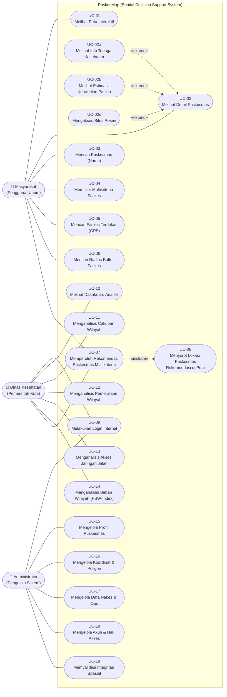

# SOFTWARE REQUIREMENTS SPECIFICATION (SRS)

## PUSKESMAP: SPATIAL DECISION SUPPORT SYSTEM UNTUK OPTIMALISASI AKSES DAN PEMERATAAN PELAYANAN PUSKESMAS DI KOTA BOGOR

**Disusun oleh: KELOMPOK 4 (A1)**

| Nama Anggota | NIM | Peran Penugasan |
|---|---|---|
| Fajar Ramadhan | J0403241021 | Project Manager |
| Kaila Puteri Iskandar | J0403241020 | UI/UX Designer & Frontend Dev |
| Kayla Fadh Suroso | J0403241034 | System Analyst & QA |
| Dila Qonita Hidayati | J0403241058 | GIS Specialist |
| Azril Zulfan | J0403241011 | Lead Backend Developer & DBA |

**TEKNOLOGI REKAYASA PERANGKAT LUNAK**
**SEKOLAH VOKASI**
**IPB UNIVERSITY**
**BOGOR**
**2026**

---

## KATA PENGANTAR

Puji dan syukur kami panjatkan ke hadirat Tuhan Yang Maha Esa atas rahmat dan karunia-Nya, sehingga dokumen Spesifikasi Kebutuhan Perangkat Lunak (Software Requirements Specification) untuk sistem PuskesMap sebagai Sistem Pendukung Keputusan Spasial pelayanan puskesmas di Kota Bogor ini dapat diselesaikan dengan baik.

Dokumen ini disusun untuk menjabarkan kebutuhan fungsional, kebutuhan nonfungsional, batasan ruang lingkup, pemodelan perilaku sistem, serta perumusan pembobotan multikriteria pada sistem PuskesMap. Spesifikasi yang tertuang di dalamnya menjadi acuan kerja bagi tim pengembang agar rancangan teknis perangkat lunak selaras dengan kebutuhan pelayanan kesehatan tingkat pertama di Kota Bogor.

Tim penyusun menyampaikan terima kasih dan penghargaan kepada seluruh pihak yang telah memberikan bimbingan serta masukan selama penyusunan dokumen ini, khususnya kepada:

1. Dr. Sofiyanti Indriasari, S.Kom., M.Kom., selaku Dosen Pengampu mata kuliah Manajemen Proyek Teknologi Informasi atas arahan metodologis dan pengelolaan ruang lingkup proyek;
2. Dr. Rina, S.Kom., M.Kom., selaku Dosen Penguji atas telaah kritis dan saran perbaikan terkait penyelenggaraan pelayanan kesehatan masyarakat; serta
3. rekan-rekan anggota Kelompok 4 Sub-Kelas A1 atas kerja sama dan kontribusi selama perancangan sistem ini.

Tim penyusun menyadari bahwa dokumen ini masih dapat terus disempurnakan seiring dinamika kebutuhan di lapangan. Oleh karena itu, saran dan masukan yang membangun sangat kami harapkan untuk pengembangan sistem PuskesMap ke depan.

Bogor, 15 Oktober 2026
Kelompok 4

---

## DAFTAR ISI

- [BAB I: Pendahuluan](#bab-i-pendahuluan)
  - [1.1 Tujuan Penulisan Dokumen](#11-tujuan-penulisan-dokumen)
  - [1.2 Ruang Lingkup Produk dan Sistem](#12-ruang-lingkup-produk-dan-sistem)
  - [1.3 Batasan Ruang Lingkup Sistem](#13-batasan-ruang-lingkup-sistem)
- [BAB II: Deskripsi Kebutuhan Pengguna](#bab-ii-deskripsi-kebutuhan-pengguna)
  - [2.1 Identifikasi Pemangku Kepentingan](#21-identifikasi-pemangku-kepentingan)
  - [2.2 Kebutuhan Pengguna dan Kriteria Penerimaan](#22-kebutuhan-pengguna-dan-kriteria-penerimaan)
  - [2.3 Karakteristik Pengguna dan Lingkungan Operasional](#23-karakteristik-pengguna-dan-lingkungan-operasional)
- [BAB III: Kebutuhan Spesifik Sistem](#bab-iii-kebutuhan-spesifik-sistem)
  - [3.1 Kebutuhan Fungsional Sistem](#31-kebutuhan-fungsional-sistem)
  - [3.2 Kebutuhan Nonfungsional Sistem](#32-kebutuhan-nonfungsional-sistem)
  - [3.3 Logika dan Formula Mesin Rekomendasi Multikriteria](#33-logika-dan-formula-mesin-rekomendasi-multikriteria)
- [BAB IV: Pemodelan Perilaku Sistem](#bab-iv-pemodelan-perilaku-sistem)
  - [4.1 Diagram Use Case Sistem PuskesMap](#41-diagram-use-case-sistem-puskesmap)
  - [4.2 Rasionalisasi Pemodelan Perilaku Sistem](#42-rasionalisasi-pemodelan-perilaku-sistem)
  - [4.3 Matriks Ketertelusuran Use Case Sistem](#43-matriks-ketertelusuran-use-case-sistem)
  - [4.4 Spesifikasi Skenario Kunci Perilaku Sistem](#44-spesifikasi-skenario-kunci-perilaku-sistem)
- [BAB V: Penutup](#bab-v-penutup)
  - [5.1 Kesimpulan Analisis Kebutuhan](#51-kesimpulan-analisis-kebutuhan)
  - [5.2 Rencana Transisi Menuju Konstruksi Perangkat Lunak](#52-rencana-transisi-menuju-konstruksi-perangkat-lunak)

### Daftar Tabel

| No | Judul |
|---|---|
| Tabel 1.1 | Matriks Fitur dalam Ruang Lingkup Sistem |
| Tabel 1.2 | Matriks Fitur di Luar Ruang Lingkup Sistem |
| Tabel 2.1 | Matriks Profil dan Wewenang Pemangku Kepentingan |
| Tabel 2.2 | Daftar User Stories dan Kriteria Penerimaan Terukur |
| Tabel 3.1 | Spesifikasi Kebutuhan Fungsional Sistem |
| Tabel 3.2 | Spesifikasi Kebutuhan Nonfungsional Sistem |
| Tabel 3.3 | Matriks Pembobotan Multikriteria Rekomendasi Puskesmas |
| Tabel 3.4 | Skenario Pembobotan Mesin Rekomendasi Multikriteria |
| Tabel 4.1 | Rasionalisasi Pemodelan Notasi Diagram Use Case |
| Tabel 4.2 | Matriks Ketertelusuran Use Case Sistem |
| Tabel 4.3 | Spesifikasi Lima Skenario Kunci Perilaku Sistem |

### Daftar Gambar

| No | Judul |
|---|---|
| Gambar 4.1 | Diagram Use Case Sistem PuskesMap |

---

## BAB I: PENDAHULUAN

### 1.1 Tujuan Penulisan Dokumen

Dokumen Spesifikasi Kebutuhan Perangkat Lunak (Software Requirements Specification atau SRS) ini merumuskan kebutuhan fungsional dan nonfungsional sistem PuskesMap sebagai Sistem Pendukung Keputusan Spasial untuk optimalisasi akses serta pemerataan pelayanan puskesmas di Kota Bogor. Dokumen ini menjadi rujukan teknis bersama bagi pengembang perangkat lunak dan pemangku kepentingan selama tahap perancangan arsitektur, pembangunan modul aplikasi, hingga pengujian kelayakan sistem.

Setiap kebutuhan pengguna di dalam dokumen ini dijabarkan menjadi fungsi sistem yang terukur, formulasi perhitungan rekomendasi, pemodelan interaksi pengguna, serta kriteria penerimaan yang dapat diverifikasi secara langsung pada tahap pengujian.

### 1.2 Ruang Lingkup Produk dan Sistem

PuskesMap merupakan aplikasi Sistem Informasi Geografis berbasis web (WebGIS) responsif yang memiliki dua peran utama, yaitu menyediakan portal informasi spasial fasilitas kesehatan tingkat pertama bagi masyarakat serta menyajikan instrumen pendukung keputusan spasial (Spatial Decision Support System atau SDSS) bagi Dinas Kesehatan Kota Bogor.

Pengembangan PuskesMap difokuskan pada tiga sasaran fungsional:

1. Membantu masyarakat menemukan lokasi dari 25 puskesmas induk di Kota Bogor menggunakan pendeteksian lokasi perangkat, informasi jam pelayanan, kesiapan layanan gawat darurat 24 jam, kelengkapan tenaga kesehatan, serta profil binaan wilayah seperti posyandu dan sekolah.
2. Menyediakan fitur rekomendasi puskesmas alternatif menggunakan metode pembobotan linier multikriteria agar warga memperoleh rujukan fasilitas yang sesuai dengan kondisi kebutuhannya.
3. Mendukung Dinas Kesehatan Kota Bogor dalam memetakan jangkauan wilayah pelayanan, mengevaluasi rasio puskesmas terhadap jumlah penduduk per kecamatan, menilai aksesibilitas jaringan jalan utama, mengidentifikasi area permukiman di luar radius layanan, serta menghitung Indeks Beban Spasial Wilayah (Puskesmas Spatial Workload Index atau PSW-Index) mengacu pada Permenkes Nomor 43 Tahun 2019.

Data geospasial dan atribut pelayanan yang dikelola di dalam PuskesMap mengintegrasikan:

- titik koordinat 25 puskesmas dari portal Satu Peta dan Dinas Kesehatan Kota Bogor,
- poligon batas administrasi 6 kecamatan beserta data kependudukan Badan Pusat Statistik Kota Bogor,
- informasi profil layanan dari situs web resmi masing-masing puskesmas pada domain kotabogor.go.id, serta
- rekapitulasi ketenagaan medis dan kunjungan pasien bulanan.

Seluruh data spasial dan relasional tersebut disimpan serta diolah menggunakan sistem basis data PostgreSQL 16 dengan ekstensi PostGIS 3.4.

### 1.3 Batasan Ruang Lingkup Sistem

Untuk menjaga ketepatan sasaran pengembangan dan mencegah perluasan fitur di luar tujuan sistem (*scope creep*), ruang lingkup PuskesMap dibagi menjadi fitur yang termasuk dalam cakupan sistem dan fitur di luar cakupan sistem. Rincian kapabilitas utama yang dibangun disajikan pada Tabel 1.1.

**Tabel 1.1: Matriks Fitur dalam Ruang Lingkup Sistem**

| No | Fitur Utama dalam Lingkup | Deskripsi Batasan Fungsional Sistem |
|---|---|---|
| 1 | Peta Interaktif WebGIS | Visualisasi spasial sebaran 25 puskesmas induk dan poligon 6 kecamatan di Kota Bogor di atas peta dasar OpenStreetMap dengan kendali lapisan peta. |
| 2 | Katalog dan Profil Puskesmas | Penyajian informasi alamat lengkap, kecamatan, kontak darurat, jam pelayanan, status IGD 24 jam, kategori layanan, serta jumlah posyandu dan sekolah binaan. |
| 3 | Pencarian Teks Puskesmas | Pencarian dinamis fasilitas kesehatan berdasarkan nama puskesmas, alamat, atau nama kecamatan dengan jeda pengetikan otomatis (debounce 300 milidetik). |
| 4 | Penyaringan Multikriteria | Penyaringan penanda puskesmas pada peta berdasarkan wilayah kecamatan, kesiapan IGD 24 jam, status jam operasional, dan kategori kelengkapan tenaga kesehatan. |
| 5 | Pendeteksian Lokasi Pengguna | Pemanfaatan sensor geolokasi peramban (HTML5 Geolocation API) maupun penandaan titik manual di peta untuk menetapkan koordinat acuan pengguna. |
| 6 | Pencarian Radius Spasial | Penapisan puskesmas yang berada dalam jangkauan radius melingkar 1 km, 3 km, atau 5 km dari posisi pengguna memanfaatkan indeks spasial GiST PostGIS. |
| 7 | Rekomendasi Multikriteria MAUT | Perhitungan peringkat tiga puskesmas prioritas menggunakan pembobotan linier atas jarak geodetik, status IGD 24 jam, jam buka, kelengkapan nakes, dan estimasi keramaian. |
| 8 | Penyorotan Lokasi Rekomendasi | Pemusatan pandangan peta otomatis dan penyorotan visual pada penanda puskesmas peringkat terbaik hasil perhitungan rekomendasi. |
| 9 | Analitik Spasial Dinas Kesehatan | Evaluasi cakupan layanan kumulatif, rasio puskesmas per 30.000 penduduk, aksesibilitas jaringan jalan utama, dan pemetaan spektrum beban wilayah PSW-Index. |
| 10 | Tata Kelola Data Master dan Audit | Pengelolaan data profil puskesmas, pembaruan koordinat geodetik, pemutakhiran data nakes dan kunjungan, manajemen akun peran internal, serta pencatatan log audit. |

Sementara itu, fungsionalitas yang dikecualikan dari cakupan pengembangan PuskesMap beserta alasan teknis dan pendekatan penggantinya dirinci pada Tabel 1.2.

**Tabel 1.2: Matriks Fitur di Luar Ruang Lingkup Sistem**

| No | Fitur di Luar Lingkup | Alasan Pembatasan Teknis dan Regulasi | Pendekatan Pengganti pada Sistem |
|---|---|---|---|
| 1 | Navigasi Rute Belokan demi Belokan | Membutuhkan layanan mesin perutean jalan raya real-time eksternal yang berada di luar kebutuhan analisis proksimitas fasilitas kesehatan tingkat kota. | Menyajikan jarak geodetik akurat berbasis kurvatur bumi, garis hubung visual pada peta, serta penyorotan penanda puskesmas tujuan. |
| 2 | Pendaftaran Antrean Pasien Online | Memerlukan antarmuka bridging dua arah dengan sistem internal SIMPUS dan antrean BPJS Kesehatan yang terikat perizinan operasional tertutup. | Menampilkan indikator estimasi tingkat keramaian pasien berdasarkan rekapitulasi rata-rata kunjungan bulanan Dinas Kesehatan. |
| 3 | Aplikasi Mobile Native Android dan iOS | Pengembangan difokuskan pada satu basis kode aplikasi web terpusat agar pemeliharaan seragam dan langsung dapat diakses warga tanpa instalasi. | Menerapkan tata letak web responsif berbasis Tailwind CSS yang menyesuaikan layar ponsel pintar hingga komputer desktop. |
| 4 | Integrasi Rekam Medis Elektronik | Data klinis individu pasien dilindungi Undang-Undang Pelindungan Data Pribadi dan regulasi kerahasiaan rekam medis Kementerian Kesehatan. | Sistem hanya mengolah data agregat pelayanan kesehatan tingkat fasilitas dan wilayah kecamatan tanpa identitas pasien. |
| 5 | Pembayaran Retribusi Layanan Digital | Transaksi keuangan publik membutuhkan integrasi gerbang pembayaran resmi kas daerah yang berada di luar ranah sistem informasi geospasial. | Menyediakan tautan langsung menuju situs resmi masing-masing puskesmas pada domain pemerintah kotabogor.go.id untuk informasi prosedur layanan. |
| 6 | Prediksi Epidemiologi Berbasis Deep Learning | Pelatihan dan inferensi model jaringan saraf membutuhkan sumber daya komputasi khusus serta riwayat data deret waktu klinis multi-tahun. | Menerapkan metode keputusan multikriteria MAUT dan formulasi indeks beban spasial PSW-Index yang transparan dan mudah diaudit. |

---

## BAB II: DESKRIPSI KEBUTUHAN PENGGUNA

### 2.1 Identifikasi Pemangku Kepentingan

Operasional sistem PuskesMap melibatkan tiga kelompok pengguna yang berinteraksi langsung dengan antarmuka aplikasi sesuai profil dan kewenangannya masing-masing sebagaimana tercantum pada Tabel 2.1.

**Tabel 2.1: Matriks Profil dan Wewenang Pemangku Kepentingan**

| Kategori Aktor | Deskripsi Pengguna | Karakteristik dan Latar Belakang | Wewenang dan Hak Akses Sistem |
|---|---|---|---|
| Masyarakat Umum | Warga Kota Bogor maupun pendatang yang membutuhkan informasi lokasi dan layanan puskesmas terdekat. | Mengakses sistem melalui peramban ponsel pintar atau komputer tanpa perlu membuat akun maupun masuk log. | Hak akses baca publik pada peta interaktif, pencarian dan filter kriteria, geolokasi radius, serta rekomendasi puskesmas. |
| Dinas Kesehatan Kota Bogor | Pejabat perencana, pengelola program kesehatan masyarakat, dan pengambil kebijakan pemerataan layanan kesehatan daerah. | Memahami standar pelayanan minimal bidang kesehatan dan regulasi kewilayahan puskesmas Permenkes Nomor 43 Tahun 2019. | Hak akses terautentikasi khusus peran pemerintah pada dasbor analitik, cakupan wilayah, rasio penduduk, PSW-Index, dan unduh laporan. |
| Administrator Sistem | Staf pengelola teknis sistem informasi kesehatan yang bertanggung jawab memelihara keakuratan data PuskesMap. | Memiliki kecakapan pengelolaan basis data relasional, validasi titik koordinat geospasial, dan tata kelola akun internal. | Hak akses penuh untuk mengelola data master puskesmas, koordinat spasial, data ketenagaan, akun pengguna, dan pemeriksaan log audit. |

### 2.2 Kebutuhan Pengguna dan Kriteria Penerimaan

Kebutuhan fungsional dari ketiga kelompok pengguna dirumuskan ke dalam 24 butir user story beserta kriteria penerimaan yang dapat diuji pada Tabel 2.2.

**Tabel 2.2: Daftar User Stories dan Kriteria Penerimaan Terukur**

| ID Story | Pernyataan Kebutuhan Pengguna | Kriteria Penerimaan Terukur | Prioritas |
|---|---|---|---|
| US-01 | Sebagai masyarakat, saya ingin melihat peta sebaran seluruh puskesmas di Kota Bogor agar mengetahui posisi fasilitas kesehatan di sekitar wilayah saya. | Peta interaktif menampilkan 25 penanda puskesmas induk di atas peta dasar OpenStreetMap dalam waktu kurang dari 1,5 detik pada jaringan internet standar. | Tinggi |
| US-02 | Sebagai masyarakat, saya ingin melihat rincian profil layanan puskesmas agar dapat memastikan kecocokan jam buka, kesiapan gawat darurat, dan cakupan binaannya. | Jendela detail puskesmas menampilkan alamat lengkap, kecamatan, kontak darurat, jam pelayanan, status IGD 24 jam, kategori layanan, serta jumlah posyandu dan sekolah binaan. | Tinggi |
| US-03 | Sebagai masyarakat, saya ingin mencari puskesmas menggunakan kata kunci nama atau wilayah agar cepat menemukan fasilitas tanpa menelusuri peta satu per satu. | Kotak pencarian menerapkan jeda input 300 milidetik dan langsung menyaring daftar puskesmas berdasarkan kecocokan nama, alamat, atau nama kecamatan. | Tinggi |
| US-04 | Sebagai masyarakat, saya ingin menyaring daftar puskesmas berdasarkan kriteria layanan tertentu agar hanya fasilitas yang relevan yang ditampilkan di peta. | Pengguna dapat memfilter penanda peta secara dinamis tanpa memuat ulang halaman berdasarkan kecamatan, status IGD 24 jam, status jam buka, dan kelengkapan tenaga kesehatan. | Tinggi |
| US-05 | Sebagai masyarakat, saya ingin menetapkan posisi saya menggunakan GPS perangkat agar sistem dapat menghitung jarak menuju setiap puskesmas secara akurat. | Sistem meminta izin geolokasi HTML5 pada peramban, menampilkan penanda titik pengguna di peta, dan menyediakan opsi penentuan titik manual apabila izin GPS ditolak. | Tinggi |
| US-06 | Sebagai masyarakat, saya ingin menampilkan puskesmas dalam radius jarak tertentu agar mengetahui pilihan fasilitas yang paling dekat untuk dijangkau. | Fungsi spasial PostGIS ST_DWithin menggambar lingkaran radius 1 km, 3 km, atau 5 km pada peta serta mengurutkan puskesmas yang masuk dalam jangkauan tersebut. | Tinggi |
| US-07 | Sebagai masyarakat, saya ingin memperoleh rekomendasi puskesmas terbaik berdasarkan kondisi kebutuhan saya agar mendapatkan rujukan layanan yang tepat. | Mesin perhitungan MAUT menghasilkan tiga puskesmas peringkat teratas beserta persentase skor utilitas akhir sesuai skenario darurat atau layanan reguler yang dipilih. | Tinggi |
| US-08 | Sebagai masyarakat, saya ingin lokasi puskesmas peringkat pertama langsung disorot pada peta agar mudah mengenali letak fasilitas yang direkomendasikan. | Kanvas peta otomatis mengarahkan pandangan ke koordinat puskesmas peringkat pertama, memberikan penanda sorotan khusus, dan membuka ringkasan profilnya. | Sedang |
| US-09 | Sebagai masyarakat, saya ingin mengetahui perkiraan tingkat keramaian pasien di puskesmas agar dapat mempertimbangkan kepadatan layanan sebelum berkunjung. | Profil puskesmas menampilkan label kepadatan Rendah, Sedang, atau Padat yang dihitung dari rata-rata kunjungan pasien bulanan terhadap kapasitas layanan bulanan. | Sedang |
| US-10 | Sebagai masyarakat, saya ingin mengakses situs web resmi puskesmas agar dapat membaca pengumuman layanan langsung dari sumber pemerintah daerah. | Setiap profil dari seluruh 25 puskesmas menyediakan tautan aktif menuju situs resmi puskesmas terkait pada subdomain pemerintah kotabogor.go.id. | Rendah |
| US-11 | Sebagai pihak Dinas Kesehatan, saya ingin memetakan cakupan wilayah layanan gabungan puskesmas agar dapat mengenali area permukiman yang belum terjangkau. | Sistem merender poligon jangkauan layanan gabungan berjarak 1,5 km atau 3,0 km menggunakan fungsi ST_Buffer dan ST_Union di atas poligon 6 kecamatan Kota Bogor. | Tinggi |
| US-12 | Sebagai pihak Dinas Kesehatan, saya ingin mengevaluasi rasio jumlah puskesmas terhadap populasi tiap kecamatan agar ketimpangan kapasitas wilayah terukur. | Dasbor analitik menampilkan grafik perbandingan rasio ketersediaan puskesmas per 30.000 jiwa penduduk untuk keenam kecamatan sesuai acuan Kementerian Kesehatan. | Tinggi |
| US-13 | Sebagai pihak Dinas Kesehatan, saya ingin melihat ringkasan indikator fasilitas kesehatan tingkat kota agar memperoleh gambaran cepat kondisi pelayanan. | Dasbor eksekutif merangkum total 25 puskesmas, jumlah puskesmas berfasilitas IGD 24 jam, rata-rata pemenuhan sembilan profesi nakes, dan distribusi per kecamatan. | Tinggi |
| US-14 | Sebagai pihak Dinas Kesehatan, saya ingin menjalankan simulasi skenario rekomendasi evaluasi pemda agar daya tampung rujukan antarwilayah dapat dianalisis. | Modul rekomendasi menyediakan pilihan skenario evaluasi kebijakan pemerintah daerah yang menitikberatkan bobot pada kelengkapan sembilan profesi tenaga kesehatan. | Sedang |
| US-15 | Sebagai pihak Dinas Kesehatan, saya ingin menganalisis keterjangkauan jaringan jalan utama terhadap lokasi puskesmas agar kendala akses transportasi teridentifikasi. | Peta analitik menampilkan lapisan ruas jalan utama dan zona jangkauan jalan per kecamatan untuk meninjau konektivitas transportasi menuju tiap puskesmas. | Sedang |
| US-16 | Sebagai pihak Dinas Kesehatan, saya ingin mengunduh tabel rekapitulasi spasial dan beban layanan puskesmas agar data mudah dilampirkan dalam laporan evaluasi. | Sistem menyediakan fitur unduh rekapitulasi atribut 25 puskesmas beserta indikator rasio dan beban wilayah ke dalam format berkas CSV serta dokumen PDF siap cetak. | Rendah |
| US-17 | Sebagai pihak Dinas Kesehatan, saya ingin masuk ke modul analitik menggunakan akun resmi agar data evaluasi internal terlindungi dari akses tanpa wewenang. | Sistem memverifikasi kredensial surel dan kata sandi terenkripsi Bcrypt serta mengakhiri sesi secara otomatis setelah 120 menit tanpa aktivitas. | Tinggi |
| US-18 | Sebagai administrator, saya ingin menambah, memperbarui, dan menghapus data profil puskesmas agar informasi fasilitas pada portal publik selalu mutakhir. | Formulir pengelolaan puskesmas memvalidasi kelengkapan kode registrasi, nama puskesmas, alamat lengkap, kecamatan, dan kontak layanan sebelum disimpan ke basis data. | Tinggi |
| US-19 | Sebagai administrator, saya ingin memperbarui titik koordinat puskesmas langsung melalui klik pada peta agar posisi penanda sesuai dengan lokasi bangunan sebenarnya. | Antarmuka pengelolaan menampilkan peta pemilih titik interaktif yang langsung mengisi nilai lintang dan bujur dalam sistem koordinat WGS 84 (SRID 4326). | Tinggi |
| US-20 | Sebagai administrator, saya ingin memperbarui komposisi sembilan profesi tenaga kesehatan dan jadwal operasional agar perhitungan rekomendasi tetap akurat. | Modul pengelolaan menyimpan jumlah tenaga pada masing-masing sembilan profesi nakes, menghitung ulang persentase kelengkapan otomatis, dan menyimpan status IGD 24 jam. | Tinggi |
| US-21 | Sebagai administrator, saya ingin sistem menolak titik koordinat yang berada di luar wilayah Kota Bogor agar tidak terjadi kesalahan penempatan lokasi puskesmas. | Penyimpanan koordinat menjalankan pemeriksaan fungsi spasial PostGIS ST_Contains terhadap batas poligon gabungan Kota Bogor dan menolak titik di luar wilayah. | Sedang |
| US-22 | Sebagai administrator, saya ingin mengelola akun pengguna internal serta status keaktifannya agar pembagian hak akses antara admin dan Dinas Kesehatan terkendali. | Panel manajemen pengguna mendukung pembuatan akun baru, penetapan peran otorisasi, serta pengaktifan atau penonaktifan akun tanpa menghapus riwayat datanya. | Sedang |
| US-23 | Sebagai administrator, saya ingin meninjau catatan riwayat perubahan data master agar setiap aktivitas penambahan, pengubahan, atau penghapusan dapat ditelusuri. | Tabel log audit merekam waktu kejadian, identitas pengguna pelaksana, jenis aksi perubahan, entitas sasaran, ringkasan perubahan, serta alamat IP pengakses. | Rendah |
| US-24 | Sebagai pihak Dinas Kesehatan, saya ingin menganalisis Indeks Beban Spasial Wilayah setiap puskesmas agar penempatan tenaga lapangan dan program UKM lebih tepat sasaran. | Sistem menghitung skor komposit PSW-Index dari empat dimensi beban (penduduk, sekolah UKS, posyandu, dan kunjungan pasien) serta memetakannya ke dalam tiga spektrum warna. | Tinggi |

### 2.3 Karakteristik Pengguna dan Lingkungan Operasional

Pengguna PuskesMap memiliki latar belakang literasi teknis yang beragam, mulai dari masyarakat umum yang membutuhkan tampilan peta sederhana tanpa pelatihan khusus, pejabat perencana Dinas Kesehatan yang membaca indikator analitik kewilayahan, hingga administrator teknis yang mengelola basis data spasial. Oleh sebab itu, tata letak antarmuka disusun mengikuti prinsip kemudahan navigasi dan kejelasan umpan balik visual agar alur pencarian fasilitas maupun pembacaan peta tematik mudah dipahami.

Dari sisi lingkungan operasional, antarmuka klien dijalankan melalui peramban web modern seperti Google Chrome versi 120 ke atas, Mozilla Firefox versi 120 ke atas, Apple Safari versi 17 ke atas, dan Microsoft Edge, baik pada layar ponsel pintar maupun komputer desktop. Pada sisi peladen, aplikasi berjalan di atas lingkungan PHP minimal versi 8.3 FPM menggunakan kerangka kerja Laravel 13 serta terhubung ke basis data PostgreSQL 16 berekstensi PostGIS 3.4 melalui koneksi terenkripsi TLS/SSL.

---

## BAB III: KEBUTUHAN SPESIFIK SISTEM

### 3.1 Kebutuhan Fungsional Sistem

Kebutuhan fungsional menjabarkan layanan pemrosesan data, interaksi peta, dan fungsi pengelolaan yang wajib disediakan oleh sistem PuskesMap beserta keterkaitannya terhadap paket kerja pengembangan pada Tabel 3.1.

**Tabel 3.1: Spesifikasi Kebutuhan Fungsional Sistem**

| Kode FR | Nama Kebutuhan Fungsional | Deskripsi Spesifikasi Teknis | Pemetaan WBS |
|---|---|---|---|
| FR-01 | Visualisasi Peta Interaktif | Sistem wajib menampilkan peta dasar OpenStreetMap dan merender 25 penanda titik puskesmas Kota Bogor dengan pembeda ikon berdasarkan status kesiapan layanan. | WBS 3.3 |
| FR-02 | Penyajian Profil Puskesmas | Sistem wajib menampilkan kartu detail saat penanda puskesmas dipilih, memuat alamat lengkap, kecamatan, kontak darurat, jam buka, status IGD 24 jam, kategori layanan, serta jumlah posyandu dan sekolah binaan. | WBS 3.3 |
| FR-03 | Pencarian Teks Puskesmas | Sistem wajib menyediakan kolom pencarian teks dengan jeda input otomatis untuk menyaring daftar puskesmas berdasarkan kecocokan nama fasilitas, alamat, atau nama kecamatan. | WBS 3.4 |
| FR-04 | Penyaringan Multikriteria | Sistem wajib menyaring penanda puskesmas pada peta secara asinkron berdasarkan kombinasi filter wilayah kecamatan, status IGD 24 jam, status jam buka, dan kategori kelengkapan nakes. | WBS 3.4 |
| FR-05 | Pendeteksian Geolokasi Pengguna | Sistem wajib mengambil koordinat lintang dan bujur pengguna melalui HTML5 Geolocation API atau klik manual di kanvas peta serta menampilkan penanda titik acuan. | WBS 3.4 |
| FR-06 | Pencarian Radius Spasial | Sistem wajib mengeksekusi fungsi geodetik PostGIS ST_DWithin untuk menampilkan daftar puskesmas dalam pilihan radius melingkar 1 km, 3 km, atau 5 km dari posisi pengguna. | WBS 3.4 |
| FR-07 | Rekomendasi Multikriteria MAUT | Sistem wajib menghitung skor utilitas dan mengurutkan tiga puskesmas terbaik menggunakan metode MAUT berdasarkan parameter jarak, kesiapan IGD 24 jam, jam operasional, kelengkapan sembilan profesi nakes, dan tingkat keramaian. | WBS 3.5 |
| FR-08 | Penyorotan Lokasi Rekomendasi | Sistem wajib menggerakkan fokus peta menuju koordinat puskesmas peringkat pertama hasil rekomendasi, memberi efek sorotan penanda, dan membuka jendela informasi utamanya. | WBS 3.5 |
| FR-09 | Pemetaan Cakupan Wilayah Layanan | Sistem wajib membentuk poligon cakupan layanan gabungan berjarak 1,5 km atau 3,0 km melalui fungsi PostGIS ST_Buffer dan ST_Union guna memperlihatkan area di luar jangkauan layanan. | WBS 3.6 |
| FR-10 | Analisis Rasio Layanan Penduduk | Sistem wajib menghitung dan memvisualisasikan perbandingan rasio ketersediaan puskesmas terhadap jumlah penduduk di keenam kecamatan mengacu pada standar 1 puskesmas per 30.000 jiwa. | WBS 3.6 |
| FR-11 | Dasbor Analitik Spasial | Sistem wajib menyajikan halaman dasbor eksekutif bagi Dinas Kesehatan yang memuat kartu ringkasan statistik fasilitas, grafik rasio antarkecamatan, dan tabel indikator beban wilayah. | WBS 3.7 |
| FR-12 | Informasi Kelengkapan Tenaga Kesehatan | Sistem wajib menampilkan rincian ketersediaan sembilan profesi tenaga kesehatan puskesmas beserta persentase pemenuhan standarnya sesuai Permenkes Nomor 43 Tahun 2019. | WBS 3.9 |
| FR-13 | Tautan Situs Resmi Puskesmas | Sistem wajib menyediakan tombol tautan langsung pada seluruh 25 profil puskesmas menuju situs web resmi masing-masing fasilitas di bawah subdomain kotabogor.go.id. | WBS 3.8 |
| FR-14 | Manajemen Autentikasi Pengguna | Sistem wajib memverifikasi identitas masuk pengguna internal menggunakan pencocokan hash kata sandi Bcrypt dan menerbitkan sesi login terenkripsi dengan regenerasi ID sesi. | WBS 3.11 |
| FR-15 | Otorisasi Akses Berbasis Peran | Sistem wajib menerapkan pemeriksaan hak akses berbasis peran untuk memisahkan kewenangan antara pengguna publik, akun pemerintah Dinas Kesehatan, dan akun administrator. | WBS 3.11 |
| FR-16 | Manajemen Data Master Puskesmas | Sistem wajib menyediakan antarmuka pembuatan, pengubahan, dan penghapusan data master profil puskesmas bagi administrator dengan validasi atribut wajib. | WBS 3.2 |
| FR-17 | Pengelolaan Koordinat Geodetik | Sistem wajib menyediakan pemilih titik interaktif pada peta bagi administrator untuk menetapkan koordinat lintang dan bujur puskesmas berproyeksi WGS 84 (SRID 4326). | WBS 3.2 |
| FR-18 | Pengelolaan Data Nakes dan Operasional | Sistem wajib memfasilitasi pembaruan jumlah staf sembilan profesi tenaga kesehatan, jadwal jam buka reguler, status IGD 24 jam, serta data kunjungan pasien bulanan oleh administrator. | WBS 3.9 |
| FR-19 | Manajemen Akun dan Pencatatan Audit | Sistem wajib menyediakan fitur pengelolaan akun internal, pengaturan status aktif pengguna, serta pencatatan log audit otomatis atas setiap mutasi data master oleh administrator. | WBS 3.11 |
| FR-20 | Validasi Batas Wilayah Spasial | Sistem wajib mengevaluasi setiap masukan koordinat puskesmas menggunakan fungsi PostGIS ST_Contains agar titik lokasi dipastikan berada di dalam poligon resmi Kota Bogor. | WBS 3.1 |
| FR-21 | Ekspor Laporan Ringkasan Spasial | Sistem wajib menyediakan fungsi pengunduhan tabel rekapitulasi profil, rasio layanan, dan skor beban spasial 25 puskesmas ke dalam format CSV dan PDF siap cetak. | WBS 3.7 |
| FR-22 | Indikator Estimasi Keramaian Pasien | Sistem wajib menghitung persentase tingkat keramaian bulanan puskesmas dan menyajikan indikator kategori kepadatan layanan kepada pengguna. | WBS 3.10 |
| FR-23 | Analisis Aksesibilitas Jaringan Jalan | Sistem wajib menampilkan lapisan ruas jalan utama dan poligon zona keterjangkauan transportasi untuk mendukung evaluasi akses fisik menuju tiap puskesmas. | WBS 3.6 |
| FR-24 | Analisis Indeks Beban Spasial Wilayah | Sistem wajib menghitung skor komposit PSW-Index dari beban kependudukan, sekolah UKS, posyandu binaan, dan kunjungan pasien serta menyajikannya pada peta tematik tiga spektrum beban. | WBS 3.6 |

### 3.2 Kebutuhan Nonfungsional Sistem

Kebutuhan nonfungsional menetapkan standar kinerja, keamanan sesi, keandalan geometri spasial, serta kualitas layanan operasional sistem PuskesMap sebagaimana dirinci pada Tabel 3.2.

**Tabel 3.2: Spesifikasi Kebutuhan Nonfungsional Sistem**

| Kode NFR | Atribut Kualitas | Spesifikasi Ambang Batas Kualitas | Metode Verifikasi |
|---|---|---|---|
| NFR-01 | Waktu Muat Awal Halaman | Waktu muat awal halaman utama peta WebGIS tidak melebihi 2,0 detik pada jaringan internet standar berkecepatan 10 Mbps. | Pengujian Google Lighthouse dan inspeksi waktu muat jaringan peramban |
| NFR-02 | Responsivitas Antarmuka | Tata letak halaman menyesuaikan ukuran layar secara proporsional mulai dari lebar ponsel pintar 360 piksel hingga monitor desktop 1920 piksel tanpa elemen saling bertumpuk. | Pengujian lintas resolusi layar dan emulasi perangkat seluler |
| NFR-03 | Kecepatan Kueri Spasial | Eksekusi kueri spasial pencarian radius dan jarak terdekat pada basis data PostGIS menghasilkan respons kurang dari 1,5 detik dengan dukungan indeks GiST. | Pengujian waktu eksekusi kueri SQL EXPLAIN ANALYZE pada PostGIS |
| NFR-04 | Portabilitas Lintas Peramban | Aplikasi berjalan konsisten pada peramban Chrome, Firefox, Safari, dan Edge terbaru di atas peladen aplikasi PHP minimal versi 8.3 FPM. | Uji fungsionalitas lintas peramban dan pemeriksaan kompatibilitas runtime |
| NFR-05 | Keamanan Kredensial dan Sesi | Kata sandi disimpan menggunakan hash Bcrypt berfaktor kerja 12, pengiriman formulir dilindungi token CSRF, dan sesi login berakhir otomatis setelah 120 menit tanpa aktivitas. | Pemeriksaan skema hash, uji pengiriman tanpa token CSRF, dan uji kedaluwarsa sesi |
| NFR-06 | Kontrol Akses Berbasis Peran | Setiap rute dasbor analitik pemerintah dan panel pengelolaan master memeriksa peran pengguna aktif sebelum mengeksekusi permintaan serta menolak akses tidak sah dengan kode HTTP 403. | Pengujian akses URL langsung menggunakan akun berbeda peran dan pengguna anonim |
| NFR-07 | Integritas Geometri Spasial | Seluruh kolom geometri titik dan multipoligon disimpan dalam proyeksi geodetik baku WGS 84 (SRID 4326) tanpa cacat topologi poligon. | Validasi fungsi spasial PostGIS ST_IsValid dan ST_SRID pada seluruh tabel spasial |
| NFR-08 | Ketersediaan Layanan Sistem | Infrastruktur aplikasi web dan basis data cloud memiliki tingkat ketersediaan layanan operasional minimal 98% per bulan kalender. | Pemantauan ketersediaan berkala pada layanan peladen aplikasi dan basis data |
| NFR-09 | Efisiensi Paginasi Data | Penyajian tabel daftar master puskesmas, akun pengguna, dan catatan log audit di halaman administrasi dibatasi 10 hingga 25 baris per halaman melalui paginasi sisi peladen. | Inspeksi pembatasan baris kueri basis data dan respons halaman tabel |
| NFR-10 | Keterbacaan dan Kontras Visual | Kombinasi warna teks, tombol kendali, dan legenda spektrum peta memenuhi rasio kontras keterbacaan standar WCAG 2.1 Level AA. | Audit aksesibilitas visual menggunakan perangkat evaluasi Google Lighthouse |
| NFR-11 | Kapasitas Permintaan Simultan | Sistem mampu melayani hingga 50 permintaan pembacaan peta dan perhitungan rekomendasi secara bersamaan tanpa kegagalan koneksi basis data. | Pengujian beban permintaan konkuren menggunakan perangkat uji beban HTTP |
| NFR-12 | Keterawatan Struktur Kode | Kode sumber memisahkan logika pengendali HTTP, layanan perhitungan domain, dan model data sesuai konvensi PSR-12 agar mudah dipelihara. | Pemeriksaan struktur modul kode dan pemeriksaan kepatuhan gaya penulisan PSR-12 |

### 3.3 Logika dan Formula Mesin Rekomendasi Multikriteria

Fitur rekomendasi puskesmas pada PuskesMap menggunakan metode Multi-Attribute Utility Theory (MAUT) linier. Setiap puskesmas dievaluasi berdasarkan lima kriteria terukur yang terlebih dahulu dinormalisasi ke dalam rentang nilai seragam [0, 1]. Skor utilitas akhir masing-masing fasilitas dihitung menggunakan persamaan linier berikut:

$$S_i = \sum_{k=1}^{m} (w_k \times N_{ik})$$

Variabel $S_i$ menyatakan nilai utilitas gabungan puskesmas ke-$i$, $w_k$ merupakan bobot kepentingan kriteria ke-$k$ dengan syarat total bobot $\sum_{k=1}^{m} w_k = 1{,}00$, dan $N_{ik}$ menunjukkan nilai kriteria ke-$k$ pada puskesmas ke-$i$ yang telah dinormalisasi menggunakan metode Min-Max sesuai sifat atribut keuntungan (*benefit*) atau biaya (*cost*). Khusus pada aspek ketenagaan, parameter evaluasi mengacu pada persentase pemenuhan standar sembilan jenis profesi tenaga kesehatan wajib berdasarkan Permenkes Nomor 43 Tahun 2019, bukan sekadar penjumlahan total staf, mengingat setiap profesi memiliki fungsi pelayanan klinis dan pembinaan masyarakat yang berbeda. Komposisi bobot kelima kriteria untuk tiga skenario penggunaan disajikan pada Tabel 3.3.

**Tabel 3.3: Matriks Pembobotan Multikriteria Rekomendasi Puskesmas**

| Kriteria Evaluasi | Sifat Atribut | Bobot Darurat | Bobot Reguler | Bobot Evaluasi Pemda | Formula Normalisasi Min-Max |
|---|---|---|---|---|---|
| Jarak Spasial Geodetik (km) | Cost (Biaya) | 0,40 (40%) | 0,20 (20%) | 0,20 (20%) | $N_{ik} = \dfrac{x_{max} - x_{ik}}{x_{max} - x_{min}}$ |
| Kesiapan Layanan IGD 24 Jam | Benefit (Manfaat) | 0,30 (30%) | 0,10 (10%) | 0,15 (15%) | $N_{ik} = 1$ jika tersedia; $0$ jika tidak |
| Durasi Jam Operasional Reguler | Benefit (Manfaat) | 0,15 (15%) | 0,30 (30%) | 0,15 (15%) | $N_{ik} = \dfrac{x_{ik} - x_{min}}{x_{max} - x_{min}}$ |
| Kelengkapan Sembilan Profesi Nakes | Benefit (Manfaat) | 0,15 (15%) | 0,20 (20%) | 0,30 (30%) | $N_{ik} = \dfrac{x_{ik} - x_{min}}{x_{max} - x_{min}}$ |
| Tingkat Estimasi Keramaian Pasien | Cost (Biaya) | 0,00 (0%) | 0,20 (20%) | 0,20 (20%) | $N_{ik} = \dfrac{x_{max} - x_{ik}}{x_{max} - x_{min}}$ |

Karakteristik sasaran pengguna dan tujuan penerapan dari ketiga skenario pembobotan tersebut dijelaskan pada Tabel 3.4.

**Tabel 3.4: Skenario Pembobotan Mesin Rekomendasi Multikriteria**

| Nama Skenario | Sasaran Pengguna | Karakteristik Pembobotan Kriteria | Keluaran Rekomendasi |
|---|---|---|---|
| Skenario Kedaruratan Medis | Masyarakat yang membutuhkan penanganan gawat darurat tingkat pertama secara cepat. | Menempatkan bobot tertinggi pada jarak terdekat (40%) dan ketersediaan layanan IGD 24 jam (30%), serta meniadakan faktor antrean reguler (0%). | Mengutamakan puskesmas terdekat yang memiliki fasilitas IGD aktif 24 jam guna memangkas waktu tempuh penanganan awal. |
| Skenario Layanan Umum Reguler | Masyarakat yang merencanakan pemeriksaan kesehatan rawat jalan atau konsultasi rutin. | Menyeimbangkan durasi jam pelayanan reguler (30%) dengan jarak tempuh (20%), kelengkapan sembilan profesi tenaga kesehatan (20%), dan tingkat keramaian rendah (20%). | Menampilkan puskesmas dengan waktu layanan memadai, komposisi tenaga kesehatan lengkap, dan kepadatan kunjungan yang lebih terkendali. |
| Skenario Evaluasi Kebijakan Pemda | Perencana Dinas Kesehatan saat menyimulasikan kesiapan rujukan pelayanan antarwilayah. | Memberikan bobot utama pada kelengkapan sembilan profesi tenaga kesehatan sesuai Permenkes 43/2019 (30%), diikuti jarak (20%) dan beban keramaian (20%). | Mengidentifikasi puskesmas dengan kesiapan sumber daya profesi paling lengkap sebagai rujukan penyangga di wilayah sekitarnya. |

---

## BAB IV: PEMODELAN PERILAKU SISTEM

### 4.1 Diagram Use Case Sistem PuskesMap

Pemodelan perilaku sistem memetakan batas interaksi antara aktor pengguna dan fungsi layanan PuskesMap. Diagram use case yang disusun mengikuti standar notasi OMG Unified Modeling Language (UML) versi 2.5 ditampilkan pada Gambar 4.1.

**Gambar 4.1: Diagram Use Case Sistem PuskesMap**

> Diagram di bawah dirender ulang dalam Mermaid dari diagram asli di PDF. Tata letak berbeda dari aslinya, tetapi aktor, use case, dan relasinya sama.

### 4.2 Rasionalisasi Pemodelan Perilaku Sistem

Penyusunan struktur relasi antar-use case pada Gambar 4.1 mengacu pada ketentuan semantik OMG UML versi 2.5.1 agar batas sistem, prakondisi autentikasi, dan pemisahan hak akses tergambar secara konsisten. Dasar pertimbangan pemodelan untuk lima aspek utama diagram dirangkum pada Tabel 4.1.

**Tabel 4.1: Rasionalisasi Pemodelan Notasi Diagram Use Case**

| No | Aspek Pemodelan | Keputusan Pemodelan UML 2.5 | Rasionalisasi Rekayasa Kebutuhan | Rujukan Kaidah Standar |
|---|---|---|---|---|
| 1 | Autentikasi Pengguna Internal | Proses masuk sistem dimodelkan sebagai satu use case tersendiri yaitu UC-09. | Autentikasi merupakan prakondisi sesi bagi pengguna internal sehingga tidak ditarik berulang dengan relasi include pada seluruh use case analitik dan administrasi. | OMG UML 2.5.1 Klausul 18.1 mengenai Use Case dan Prakondisi |
| 2 | Pemeriksaan Hak Akses Peran | Verifikasi peran dijalankan oleh mekanisme kontrol akses internal sistem pada setiap permintaan halaman. | Pengecekan otorisasi peran merupakan aturan pengamanan infrastruktur sistem, bukan tujuan bisnis mandiri yang diinisiasi oleh aktor manusia. | OMG UML 2.5.1 Klausul 18.1.3 mengenai Batas Subjek Sistem |
| 3 | Pemisahan Modul Publik dan Kebijakan | Use case eksplorasi peta masyarakat dipisahkan dari kelompok use case analitik Dinas Kesehatan. | Menjaga keterbacaan batas wewenang akses terbuka bagi warga terhadap fungsi evaluasi kebijakan internal pemerintah daerah. | Prinsip Hak Akses Minimum pada Kontrol Akses Berbasis Peran |
| 4 | Penyorotan Lokasi Hasil Rekomendasi | UC-08 dihubungkan melalui relasi «include» yang selalu menyertai eksekusi UC-07. | Setiap perhitungan rekomendasi fasilitas selalu diakhiri dengan pemusatan peta dan penyorotan penanda puskesmas terpilih tanpa fitur navigasi rute belokan. | OMG UML 2.5.1 Klausul 18.1.3 mengenai Relasi Include Wajib |
| 5 | Evaluasi Beban Spasial Wilayah | UC-14 memodelkan analisis Indeks Beban Spasial Wilayah secara khusus bagi aktor Dinas Kesehatan. | Merepresentasikan kebutuhan pemantauan beban Upaya Kesehatan Masyarakat meliputi binaan penduduk, posyandu, dan sekolah selain kunjungan kuratif. | Permenkes Nomor 43 Tahun 2019 dan Spesifikasi FR-24 |

### 4.3 Matriks Ketertelusuran Use Case Sistem

Hubungan ketertelusuran antara ke-19 use case sistem, aktor yang berwenang, serta kebutuhan fungsional yang dipenuhi dipetakan pada Tabel 4.2.

**Tabel 4.2: Matriks Ketertelusuran Use Case Sistem**

| Kode UC | Nama Use Case Sistem | Aktor Berwenang | Pemetaan Kebutuhan |
|---|---|---|---|
| UC-01 | Melihat Peta Interaktif dan Sebaran Puskesmas | Masyarakat Umum | FR-01 |
| UC-02 | Melihat Detail Puskesmas (beserta ekstensi UC-02a Melihat Info Tenaga Kesehatan, UC-02b Melihat Estimasi Keramaian Pasien, dan UC-02c Mengakses Situs Resmi) | Masyarakat Umum | FR-02, FR-12, FR-13, FR-22 |
| UC-03 | Mencari Puskesmas Berdasarkan Nama atau Wilayah | Masyarakat Umum | FR-03 |
| UC-04 | Memfilter Puskesmas Multikriteria | Masyarakat Umum | FR-04 |
| UC-05 | Mencari Puskesmas Terdekat via GPS | Masyarakat Umum | FR-05 |
| UC-06 | Mencari Puskesmas dalam Radius Spasial | Masyarakat Umum | FR-06 |
| UC-07 | Memperoleh Rekomendasi Puskesmas Multikriteria | Masyarakat Umum, Dinas Kesehatan | FR-07 |
| UC-08 | Menyorot Lokasi Puskesmas Rekomendasi di Peta | Masyarakat Umum, Dinas Kesehatan (di-include oleh UC-07) | FR-08 |
| UC-09 | Melakukan Login Internal | Dinas Kesehatan, Administrator | FR-14, FR-15, NFR-05, NFR-06 |
| UC-10 | Melihat Dasbor Analitik Kesehatan | Dinas Kesehatan | FR-11, FR-21 |
| UC-11 | Menganalisis Cakupan Wilayah Layanan | Dinas Kesehatan | FR-09 |
| UC-12 | Menganalisis Pemerataan Rasio Wilayah | Dinas Kesehatan | FR-10 |
| UC-13 | Menganalisis Aksesibilitas Jaringan Jalan | Dinas Kesehatan | FR-23 |
| UC-14 | Menganalisis Beban Spasial Wilayah | Dinas Kesehatan | FR-24 |
| UC-15 | Mengelola Profil Master Puskesmas | Administrator | FR-16 |
| UC-16 | Mengelola Titik Koordinat Spasial | Administrator | FR-17, FR-20 |
| UC-17 | Mengelola Data Tenaga Kesehatan dan Operasional | Administrator | FR-18 |
| UC-18 | Mengelola Akun Pengguna dan Log Audit | Administrator | FR-19 |
| UC-19 | Memvalidasi Integritas Batas Spasial | Administrator | FR-20, NFR-07 |

Administrator sistem juga memiliki hak supervisi terhadap tampilan publik dan fitur analitik melalui mekanisme kontrol akses berbasis peran, sedangkan pemetaan pada Gambar 4.1 menonjolkan aktor utama yang menginisiasi masing-masing aktivitas.

### 4.4 Spesifikasi Skenario Kunci Perilaku Sistem

Tabel 4.3 menjabarkan spesifikasi interaksi sistem mengacu pada standar IEEE 830 untuk lima use case inti PuskesMap, meliputi pencarian puskesmas terdekat berbasis GPS, perhitungan rekomendasi multikriteria MAUT, penyorotan lokasi hasil rekomendasi pada peta, analisis cakupan wilayah layanan, serta evaluasi beban spasial wilayah.

**Tabel 4.3: Spesifikasi Lima Skenario Kunci Perilaku Sistem**

#### UC-05: Mencari Puskesmas Terdekat via GPS

**Aktor:** Masyarakat Umum

**Prakondisi:** Pengguna mengizinkan akses geolokasi pada peramban atau memilih titik acuan di dalam wilayah Kota Bogor.

**Alur utama interaksi:**

1. Pengguna menekan tombol *Gunakan Lokasi Saya* pada panel kendali peta.
2. Peramban mengirimkan koordinat lintang dan bujur pengguna ke peladen aplikasi.
3. Sistem menghitung jarak geodetik menuju 25 puskesmas menggunakan fungsi PostGIS ST_Distance berindeks GiST (NFR-03).
4. Sistem mengirimkan kembali daftar puskesmas terurut dari jarak terdekat dalam format GeoJSON tanpa memuat ulang halaman.

**Pascakondisi dan luaran sistem:** Peta memusatkan tampilan ke titik acuan pengguna, menandai posisi pengguna, serta menampilkan urutan puskesmas terdekat beserta jarak tempuh lurusnya dalam satuan kilometer.

---

#### UC-07: Memperoleh Rekomendasi Puskesmas Multikriteria

**Aktor:** Masyarakat Umum, Dinas Kesehatan

**Prakondisi:** Titik lokasi acuan pengguna sudah ditetapkan dan skenario prioritas kebutuhan telah dipilih.

**Alur utama interaksi:**

1. Pengguna memilih skenario kebutuhan (Kedaruratan Medis, Layanan Reguler, atau Evaluasi Pemda) lalu menekan tombol *Cari Rekomendasi*.
2. Sistem memeriksa keabsahan koordinat masukan dalam batas wilayah Kota Bogor.
3. Mesin rekomendasi menormalisasi nilai Min-Max kelima kriteria dan menghitung skor utilitas linier $S_i = \sum_{k=1}^{m} (w_k \times N_{ik})$.
4. Sistem mengurutkan nilai skor tertinggi, menetapkan tiga puskesmas teratas, dan menjalankan UC-08 secara otomatis.

**Pascakondisi dan luaran sistem:** Panel samping menampilkan kartu tiga puskesmas peringkat tertinggi lengkap dengan rincian skor utilitas, status IGD 24 jam, kelengkapan nakes, dan indikator keramaian.

---

#### UC-08: Menyorot Lokasi Puskesmas Rekomendasi di Peta

**Aktor:** Masyarakat Umum, Dinas Kesehatan

**Prakondisi:** Perhitungan peringkat rekomendasi pada UC-07 telah selesai menghasilkan puskesmas peringkat pertama.

**Alur utama interaksi:**

1. Antarmuka peta menerima data koordinat dan atribut puskesmas peringkat pertama dari keluaran UC-07.
2. Kanvas peta menjalankan transisi pergeseran fokus pandangan menuju titik koordinat puskesmas tersebut.
3. Sistem memberikan penanda visual pembeda pada titik puskesmas peringkat pertama dan membuka jendela ringkasan profilnya.

**Pascakondisi dan luaran sistem:** Lokasi puskesmas rekomendasi utama terlihat menonjol di tengah kanvas peta disertai informasi alamat, kontak darurat, jam pelayanan, dan tautan situs resminya.

---

#### UC-11: Menganalisis Cakupan Wilayah Layanan

**Aktor:** Dinas Kesehatan

**Prakondisi:** Pengguna telah masuk menggunakan akun berperan Dinas Kesehatan yang aktif.

**Alur utama interaksi:**

1. Pengguna membuka halaman dasbor analitik spasial dan memilih menu cakupan wilayah layanan.
2. Pengguna memilih parameter radius jangkauan pelayanan sebesar 1,5 km atau 3,0 km.
3. Sistem menjalankan perhitungan geometri penyangga melalui fungsi PostGIS ST_Buffer dan menggabungkannya dengan ST_Union.
4. Sistem menampilkan lapisan poligon jangkauan transparan di atas peta batas administrasi 6 kecamatan Kota Bogor.

**Pascakondisi dan luaran sistem:** Peta analitik memperlihatkan area cakupan gabungan 25 puskesmas sekaligus menampakkan area permukiman yang belum terlayani di luar batas radius.

---

#### UC-14: Menganalisis Beban Spasial Wilayah

**Aktor:** Dinas Kesehatan

**Prakondisi:** Pengguna berwenang telah terautentikasi pada dasbor analitik kebijakan Dinas Kesehatan.

**Alur utama interaksi:**

1. Pengguna membuka menu evaluasi beban wilayah binaan dan menentukan cakupan kecamatan atau seluruh Kota Bogor.
2. Sistem menghimpun empat variabel beban (rasio penduduk, jumlah sekolah UKS, jumlah posyandu, dan rata-rata kunjungan bulanan).
3. Sistem melakukan normalisasi Min-Max tiap dimensi dan menghitung indeks gabungan PSW-Index sesuai bobot Permenkes 43/2019.
4. Sistem mengelompokkan ke-25 puskesmas ke dalam tiga spektrum beban kerja dan mengirimkan payload peta tematik.

**Pascakondisi dan luaran sistem:** Dasbor menampilkan peta tematik tiga spektrum warna (Beban Tinggi, Ideal, dan Rendah), grafik perbandingan beban, serta daftar puskesmas prioritas intervensi.

---

## BAB V: PENUTUP

### 5.1 Kesimpulan Analisis Kebutuhan

Dokumen Spesifikasi Kebutuhan Perangkat Lunak ini merangkum landasan kebutuhan sistem PuskesMap dengan memadukan penyelenggaraan Upaya Kesehatan Perseorangan (UKP) dan Upaya Kesehatan Masyarakat (UKM) berdasarkan Permenkes Nomor 43 Tahun 2019. Cakupan spesifikasi meliputi 24 kebutuhan fungsional, 12 kebutuhan nonfungsional terukur, formulasi rekomendasi multikriteria MAUT, serta pemodelan 19 use case sesuai kaidah OMG UML 2.5 di atas lingkungan Laravel 13 dan basis data spasial PostgreSQL/PostGIS.

Penetapan batasan ruang lingkup serta kriteria penerimaan pada setiap kebutuhan menjaga agar pengembangan perangkat lunak terarah pada penyediaan informasi akses fasilitas kesehatan bagi warga Kota Bogor sekaligus penyajian instrumen analitik spasial bagi Dinas Kesehatan.

### 5.2 Rencana Transisi Menuju Konstruksi Perangkat Lunak

Spesifikasi kebutuhan ini menjadi acuan langsung bagi tahap perancangan arsitektur perangkat lunak, pembentukan skema basis data spasial delapan tabel PostGIS, pemrosesan dan validasi dataset geospasial Kota Bogor, serta pembangunan modul aplikasi web. Seluruh pengujian fungsional dan evaluasi performa pada tahap akhir konstruksi akan diverifikasi terhadap kriteria penerimaan terukur di dalam dokumen ini.
