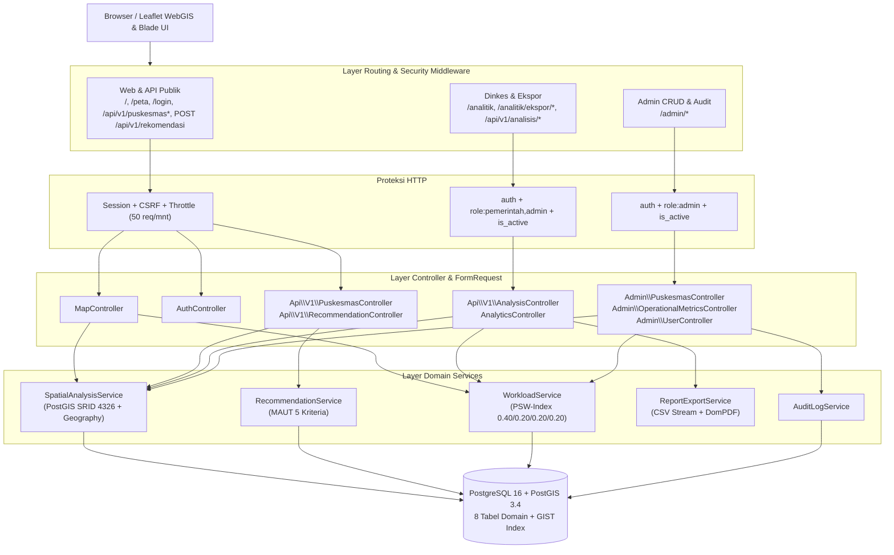
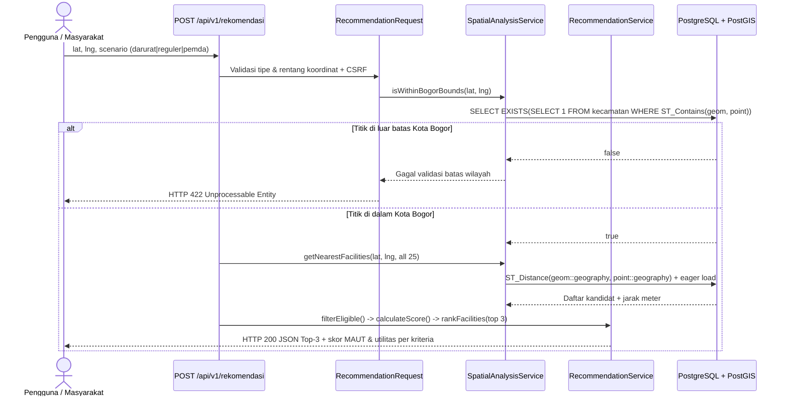

# Rencana Implementasi Backend — PuskesMap Kota Bogor (SDSS)

Dokumen ini merupakan rancangan teknis implementasi backend **PuskesMap Kota Bogor** (_Spatial Decision Support System_ / SDSS) berbasis **Laravel 13** (PHP `>= 8.3`, runtime PHP `8.5`) dan **PostgreSQL 16 + PostGIS 3.4** dengan acuan utama **Software Architecture Document (SAD) (revisi 12)**, **Software Requirements Specification (SRS) (revisi 12)**, spesifikasi di `docs/specs/`, skema SQL di `docs/sql/`, serta dataset resmi 2025–2026 di `database/seeders/csv/`.

> [!NOTE]
> **Pembaruan Konsolidasi Team Lead (13 Nov 2026):** Seluruh angka resmi telah diselaraskan ke dataset 2025–2026 (`kapasitas_maksimal_bulanan = 850`, `jam_tutup = 14:00:00`), `search_path=public,extensions` untuk Supabase, GeoJSON `Cache::rememberForever` + `ST_AsGeoJSON(..., 6)`, serta pembatasan skenario `pemda` hanya untuk `pemerintah`/`admin`. Untuk pembagian area tim dan aturan terbaru lihat [`docs/TEAM_GUIDE.md`](./TEAM_GUIDE.md).

---

## Ringkasan Tujuan & Keputusan Arsitektur

Berdasarkan kondisi codebase saat ini (prototipe `/peta` yang membaca `App\Support\PuskesmasStaticDataset`, tiga kelas _stub_ pada `app/Services/`, autentikasi belum terhubung, dan `.env` / `phpunit.xml` masih memakai `mysql` & `sqlite`) serta keputusan Anda pada klarifikasi arsitektur, rencana ini mencakup:

1. **Database Spasial Native (PostgreSQL 16 + PostGIS 3.4):** Memindahkan target `.env` dan `phpunit.xml` ke PostgreSQL + PostGIS (dengan _driver guard_ yang aman pada migrasi), memodelkan seluruh **8 tabel domain** sesuai SAD Tabel 5.1–5.8 & `docs/sql/01_schema.sql`, serta mengisi data kanonik dari `database/seeders/csv/*.csv` (`6` kecamatan, `25` puskesmas, `25` operasional, `25` tenaga medis, `300` kunjungan pasien tahun 2025, `37` zona jangkauan jalan).
2. **Engine Analitik & SDSS Backend (`app/Services/`):** Mengimplementasikan `SpatialAnalysisService` (PostGIS `ST_Distance`, `ST_DWithin`, `ST_Buffer`, `ST_Contains`, `ST_Difference`, `ST_Area`), `RecommendationService` (MAUT 5 kriteria untuk skenario `darurat`, `reguler`, `pemda`), `WorkloadService` (PSW-Index + spektrum `Tinggi`/`Ideal`/`Rendah`), `AuditLogService`, dan `ReportExportService`.
3. **Auth, RBAC & Keamanan (`NFR-01`–`NFR-06`):** Login/Logout berbasis session database (`lifetime = 120` menit), _rate limiting_, pengecekan `is_active`, serta middleware `CheckRole` yang mengembalikan **HTTP 403** bagi role yang tidak berwenang.
4. **7 Endpoint `/api/v1/*`, Analitik Dinkes + Ekspor CSV/PDF (`FR-21`), & CRUD Admin:** Mendukung API publik & terproteksi, pemasangan **`barryvdh/laravel-dompdf`** untuk ekspor PDF server-side selain stream CSV, manajemen data master dengan validasi poligon Kota Bogor + recalculation `skor_psw` otomatis + `audit_log`, dan paginasi `10–25` baris (`NFR-09`).
5. **Transisi `MapController` & `/login` ke Database:** Memperbarui `MapController::index` dan `AuthController` agar bersumber dari PostgreSQL/Eloquent sambil menjaga struktur JSON `#puskesmas-data` tetap kompatibel dengan `resources/js/map/sdss-map.js` dan menjaga halaman publik `/peta` bebas dari komponen Dinkes (memastikan `Tests\Feature\MapPageTest` tetap lulus).

---

## Arsitektur Target & Alur Data

### Alur Kunci `POST /api/v1/rekomendasi` (SAD Gambar 4.1)

---

## Prasyarat & Persetujuan Pengguna (`User Review Required`)

> [!IMPORTANT]
> Sebelum mengeksekusi fase implementasi, item lingkungan dan dependensi berikut membutuhkan kesiapan dari pihak pengguna/mesin lokal:
>
> 1. **Instance PostgreSQL 16 + PostGIS 3.4:** Saat pemeriksaan lingkungan, ekstensi PHP `pdo_pgsql` sudah aktif, namun utilitas CLI `psql` tidak tersedia di `PATH`, `.env` menunjuk ke `mysql`, dan `phpunit.xml` menunjuk ke `sqlite :memory:`. Pastikan database PostgreSQL + PostGIS untuk dev (mis. `puskesmap`) dan testing terpisah (mis. `puskesmap_test`) tersedia beserta ekstensi `postgis`, serta kredensial `DB_HOST`, `DB_PORT`, `DB_DATABASE`, `DB_USERNAME`, `DB_PASSWORD`.
> 2. **Instalasi Paket PDF (`FR-21`):** Sesuai persetujuan pada langkah klarifikasi, fase implementasi akan menjalankan `composer require barryvdh/laravel-dompdf --no-interaction` (mengubah `composer.json` dan `composer.lock`).
> 3. **Rekonsiliasi Data Prototipe vs Dataset Resmi 2025–2026:** `PuskesmasStaticDataset` memiliki perbedaan data dibanding `database/seeders/csv/` (mis. jam poli reguler `07:30:00–14:00:00`, kapasitas baku `850`, serta label `Rendah|Sedang|Padat`). `MapController` membaca data resmi PostgreSQL dan menyediakan _mapping_ kompatibel sampai perombakan UI OneMap (`T-02`).

---

## Rencana Perubahan Terperinci (`Proposed Changes`)

### Komponen 1: Infrastruktur, Konfigurasi, Dependensi & Routing Core

#### [MODIFY] `composer.json` & `composer.lock`

- Tambah dependensi `barryvdh/laravel-dompdf` untuk ekspor laporan analitik PDF (`FR-21`).

#### [MODIFY] `.env`, `.env.example`, dan `phpunit.xml`

- `.env` & `.env.example`: set `DB_CONNECTION=pgsql`, `DB_PORT=5432`, `SESSION_DRIVER=database`, `SESSION_LIFETIME=120`.
- `phpunit.xml`: ganti `DB_CONNECTION` dari `sqlite` ke `pgsql` dan `DB_DATABASE` ke `puskesmap_test` (menjaga isolasi terhadap database dev saat `LazilyRefreshDatabase` berjalan).

#### [NEW] `config/sdss.php`

Memusatkan konstanta domain sesuai aturan `config.md` agar tidak tersebar sebagai _magic numbers_:

- `maut.weights`:
    - `darurat`: `['distance' => 0.40, 'igd' => 0.30, 'hours' => 0.15, 'nakes' => 0.15, 'crowd' => 0.00]`
    - `reguler`: `['hours' => 0.30, 'distance' => 0.20, 'nakes' => 0.20, 'crowd' => 0.20, 'igd' => 0.10]`
    - `pemda`: `['nakes' => 0.30, 'distance' => 0.20, 'crowd' => 0.20, 'igd' => 0.15, 'hours' => 0.15]`
- `psw.weights`: `['pop' => 0.40, 'edu' => 0.20, 'pos' => 0.20, 'kur' => 0.20]`
- `psw.thresholds`: `['high' => 0.70, 'ideal' => 0.40]`
- `capacity.default_monthly`: `850`, ambang kepadatan `60.0` (`Rendah`) dan `85.0` (`Sedang`/`Padat`)
- `equity.population_per_facility`: `30000`
- `coverage.allowed_buffers_km`: `[1.5, 3.0]`
- `pagination.default_per_page`: `15` (dalam batas `10–25` per `NFR-09`)

#### [MODIFY] `app/Providers/AppServiceProvider.php`

- Aktifkan `Model::preventLazyLoading(! app()->isProduction());` untuk mendeteksi N+1 saat pengembangan/pengujian.
- Daftarkan _named rate limiter_:
    - `RateLimiter::for('login', ...)` (maks. `5` percobaan per menit berbasis `strtolower($request->input('email')).'|'.$request->ip()`).
    - `RateLimiter::for('api', ...)` (`Limit::perMinute(50)->by($request->user()?->id ?: $request->ip())`, selaras target `NFR-10`).

#### [NEW] `app/Http/Middleware/CheckRole.php`

- Memeriksa `$request->user()` terautentikasi, `$request->user()->is_active === true`, dan `$request->user()->role->value` termasuk dalam daftar parameter `$roles` (contoh `role:pemerintah,admin`).
- Jika tidak terautentikasi -> redirect `login` (web) atau JSON `401` (API); jika nonaktif atau role tidak cocok -> `abort(403, 'Akses ditolak.')` sesuai `NFR-04`.

#### [MODIFY] `bootstrap/app.php`

- Registrasikan alias middleware `'role' => CheckRole::class` pada `withMiddleware(...)`.
- Pertahankan `$exceptions->shouldRenderJsonWhen(fn (Request $request) => $request->is('api/*') || $request->expectsJson());`.
- **Keputusan Routing `/api/v1/*`:** Di Laravel 13, parameter `api:` pada `withRouting(...)` memakai grup middleware `api` yang bersifat _stateless_ (tanpa session cookie & CSRF). Karena `/api/v1/analisis/*` membutuhkan autentikasi session web + `CheckRole` (`FR-15`, `NFR-06`) dan `POST /api/v1/rekomendasi` dipanggil _same-origin_ dari antarmuka WebGIS (`NFR-05` CSRF) tanpa menambah Sanctum, maka `routes/api_v1.php` didaftarkan melalui `then:` pada `withRouting(...)` di dalam grup `Route::prefix('api/v1')->name('api.v1.')->middleware(['web', 'throttle:api'])`. Dengan demikian, session + CSRF tetap aktif sekaligus seluruh error `/api/*` tetap dirender sebagai JSON.

---

### Komponen 2: Domain Enums, Skema PostGIS (8 Tabel), Models & ETL Seeder

#### [NEW] `app/Enums/*.php`

Semua enum memakai key `TitleCase` sesuai `AGENTS.md`:

- `UserRole`: `Admin = 'admin'`, `Pemerintah = 'pemerintah'`
- `AuditAction`: `Insert = 'INSERT'`, `Update = 'UPDATE'`, `Delete = 'DELETE'`, `Deactivate = 'DEACTIVATE'`
- `ServiceCategory`: `RawatInap = 'Rawat Inap'`, `NonRawatInap = 'Non Rawat Inap'`
- `NakesCategory`: `Lengkap = 'Lengkap'`, `KurangLengkap = 'Kurang Lengkap'`
- `CrowdStatus`: `Rendah = 'Rendah'`, `Sedang = 'Sedang'`, `Padat = 'Padat'` (menyertakan method `toMapLabel(): string` yang mengembalikan `'Sepi' | 'Sedang' | 'Ramai'` untuk kompatibilitas JS `/peta`)
- `WorkloadSpectrum`: `Rendah = 'Rendah'`, `Ideal = 'Ideal'`, `Tinggi = 'Tinggi'` (plus method `colorHex(): string` -> `#2563EB`, `#16A34A`, `#DC2626` sesuai SAD Tabel 10.3)
- `MautScenario`: `Darurat = 'darurat'`, `Reguler = 'reguler'`, `Pemda = 'pemda'`

#### [NEW] Migrasi Basis Data (`database/migrations/`)

Urutan kronologis sesuai ketergantungan _foreign key_ (seluruh statement DDL khusus PostgreSQL/PostGIS seperti `CREATE EXTENSION`, tipe kolom `GEOMETRY(..., 4326)`, `CHECK`, dan indeks `GIST` dibungkus guard `DB::getDriverName() === 'pgsql'`):

| No  | File Migrasi                                    | Tabel / Perubahan  | Spesifikasi Kunci (SAD Tabel 5.1–5.8 & `01_schema.sql`)                                                                                                                                                                                                                                                                                                           |
| --- | ----------------------------------------------- | ------------------ | ----------------------------------------------------------------------------------------------------------------------------------------------------------------------------------------------------------------------------------------------------------------------------------------------------------------------------------------------------------------- | ------ | ------ | -------------------------------------------------------------------------------------------------------------------------------------------------------- |
| 1   | `..._enable_postgis_extension.php`              | Extension          | `CREATE EXTENSION IF NOT EXISTS postgis;`                                                                                                                                                                                                                                                                                                                         |
| 2   | `..._add_role_and_is_active_to_users_table.php` | `users`            | Kolom `role VARCHAR(20) DEFAULT 'pemerintah'`, `is_active BOOLEAN DEFAULT true`, CHECK `role IN ('admin','pemerintah')`                                                                                                                                                                                                                                           |
| 3   | `..._create_kecamatan_table.php`                | `kecamatan`        | `kode_kecamatan` UK, `nama_kecamatan`, `geom GEOMETRY(MultiPolygon, 4326)` + `idx_kecamatan_geom GIST`, `jumlah_penduduk`, `luas_wilayah_km2`                                                                                                                                                                                                                     |
| 4   | `..._create_puskesmas_table.php`                | `puskesmas`        | `kecamatan_id` FK (`ON DELETE RESTRICT`), `kode_puskesmas` UK, `nama_puskesmas`, `alamat`, `geom GEOMETRY(Point, 4326)` + `idx_puskesmas_geom GIST` + `idx_puskesmas_geog GIST((geom::geography))`, `x_long`, `y_lat`, `website_url`, `kategori_layanan` (default `'Non Rawat Inap'`), `jumlah_posyandu`, `jumlah_sekolah`, `skor_psw DECIMAL(5,2)`, `timestamps` |
| 5   | `..._create_operasional_table.php`              | `operasional`      | `puskesmas_id` FK UK (`ON DELETE CASCADE`), `status_igd_24jam` BOOL(false), `jam_buka` TIME(`07:30:00`), `jam_tutup` TIME(`14:00:00`), `kontak_darurat`, `rawat_inap` BOOL(false)                                                                                                                                                                                 |
| 6   | `..._create_tenaga_medis_table.php`             | `tenaga_medis`     | `puskesmas_id` FK UK (`ON DELETE CASCADE`), 9 profesi integer (`dokter_umum`, `dokter_gigi`, `bidan`, `perawat`, `farmasi`, `gizi`, `kesling`, `kesmas`, `atlm`), `persentase_kelengkapan` DOUBLE PRECISION, `kategori_jumlah_nakes`                                                                                                                              |
| 7   | `..._create_kunjungan_pasien_table.php`         | `kunjungan_pasien` | `puskesmas_id` FK (`ON DELETE CASCADE`), `bulan (1..12)`, `tahun`, `total_pasien_bulanan`, `kapasitas_maksimal_bulanan (850)`, `persentase_keramaian`, `status_kepadatan`, `UNIQUE(puskesmas_id, tahun, bulan)`                                                                                                                                                  |
| 8   | `..._create_jangkauan_jalan_table.php`          | `jangkauan_jalan`  | `kecamatan_id` FK (`ON DELETE CASCADE`), `kategori_jangkauan`, `jangkauan_faskes`, `jangkauan_jalan`, `geom GEOMETRY(MultiPolygon, 4326)` + `idx_jangkauan_geom GIST`                                                                                                                                                                                             |
| 9   | `..._create_audit_log_table.php`                | `audit_log`        | `user_id` FK (`ON DELETE RESTRICT`), `aksi` (`INSERT                                                                                                                                                                                                                                                                                                              | UPDATE | DELETE | DEACTIVATE`), `tabel_target`, `target_id`, `deskripsi_perubahan`, `ip_address VARCHAR(45)`, `created_at`+ indeks`(tabel_target, target_id)`&`created_at` |

> [!NOTE]
> `01_schema.sql` belum menyertakan `users.is_active`, `timestamps` pada `puskesmas`/`users`, indeks fungsional `idx_puskesmas_geog`, serta klausa eksplisit `ON DELETE RESTRICT` pada `puskesmas.kecamatan_id`. Rancangan migrasi ini menerapkan _superset_ sesuai SAD Tabel 5.1–5.8.

#### [NEW] / [MODIFY] Eloquent Models (`app/Models/`) — 8 Model

- `[MODIFY] app/Models/User.php`: tambah `'role'`, `'is_active'` ke `#[Fillable]`, cast `'role' => UserRole::class` dan `'is_active' => 'boolean'`, helper `isAdmin(): bool`, `isPemerintah(): bool`, relasi `auditLogs(): HasMany`.
- `[NEW] app/Models/Kecamatan.php`: `$table = 'kecamatan'`, `$timestamps = false`, relasi `puskesmas(): HasMany`, `jangkauanJalan(): HasMany`.
- `[NEW] app/Models/Puskesmas.php`: `$table = 'puskesmas'`, relasi `kecamatan(): BelongsTo`, `operasional(): HasOne`, `tenagaMedis(): HasOne`, `kunjunganPasien(): HasMany`, serta dynamic subquery relationship `scopeWithLatestKunjungan()` + `latestKunjungan(): BelongsTo` (mengambil `id` terbaru berdasarkan `orderByDesc('tahun')->orderByDesc('bulan')` dalam satu query tanpa N+1).
- `[NEW] app/Models/Operasional.php`: `$table = 'operasional'`, `$timestamps = false`, helper `durationHours(): float` (menghitung durasi operasional; bila `status_igd_24jam` aktif tetap menyediakan opsi durasi jam buka–tutup atau `24.0` sesuai aturan skoring — lihat Komponen 3).
- `[NEW] app/Models/TenagaMedis.php`: `$table = 'tenaga_medis'`, `$timestamps = false`, helper `countProfessionsPresent(): int`, `totalPersonnel(): int`, dan `recomputeCompleteness(): void` (mengisi `persentase_kelengkapan = round((profesi_terisi / 9) * 100, 1)` & `kategori_jumlah_nakes`).
- `[NEW] app/Models/KunjunganPasien.php`: `$table = 'kunjungan_pasien'`, `$timestamps = false`, cast `status_kepadatan => CrowdStatus::class`, helper `recomputeDensity(): void`.
- `[NEW] app/Models/JangkauanJalan.php`: `$table = 'jangkauan_jalan'`, `$timestamps = false`, relasi `kecamatan(): BelongsTo`.
- `[NEW] app/Models/AuditLog.php`: `$table = 'audit_log'`, `const UPDATED_AT = null;`, cast `aksi => AuditAction::class`, relasi `user(): BelongsTo`.

#### [NEW] / [MODIFY] Factories & ETL Seeders (`database/factories/`, `database/seeders/`)

- `[MODIFY] database/factories/UserFactory.php`: tambah state `admin()`, `pemerintah()`, dan `inactive()`.
- `[NEW]` `KecamatanFactory`, `PuskesmasFactory`, `OperasionalFactory`, `TenagaMedisFactory`, `KunjunganPasienFactory`, `JangkauanJalanFactory` (untuk tes unit/fitur yang ringkas menggunakan poligon/titik WKT valid di wilayah Bogor tanpa perlu memuat seluruh CSV multi-megabyte di tiap test case).
- `[NEW] database/seeders/DatasetBogorSeeder.php`:
    - Membaca langsung dari `database/seeders/csv/*.csv` (`kecamatan.csv`, `puskesmas.csv`, `operasional.csv`, `tenaga_medis.csv`, `kunjungan_pasien.csv`, `jangkauan_jalan.csv`) secara berurutan dan idempoten dalam `DB::transaction()`.
    - Menyisipkan `geom` via `ST_GeomFromText(?, 4326)` dan memastikan seluruh `geom` valid (`ST_IsValid`).
    - Memanggil `WorkloadService::recalculateAndPersistScores()` setelah insert selesai untuk mengisi `puskesmas.skor_psw` (yang memang kosong pada `puskesmas.csv`, setara `docs/sql/05_hitung_psw.sql`).
- `[NEW] database/seeders/UserSeeder.php`: menyediakan akun default dev terverifikasi (`admin` & `pemerintah` Dinas Kesehatan dengan `Hash::make` cost 12) dan `[MODIFY] database/seeders/DatabaseSeeder.php` memanggil keduanya secara terurut.

---

### Komponen 3: Domain Services (Core SDSS Engine)

#### [MODIFY] `app/Services/SpatialAnalysisService.php`

Mengimplementasikan kontrak SAD Tabel 3.1 + validasi batas Kota Bogor:

- `isWithinBogorBounds(float $lat, float $lng): bool`: `SELECT EXISTS(SELECT 1 FROM kecamatan WHERE ST_Contains(geom, ST_SetSRID(ST_MakePoint(?, ?), 4326)))`.
- `findDistrictForPoint(float $lat, float $lng): ?Kecamatan`: mengembalikan kecamatan tempat koordinat berada (untuk auto-resolve atau verifikasi `kecamatan_id`).
- `getNearestFacilities(float $lat, float $lng, ?int $limit = null, array $filters = []): Collection`:
    - Memanfaatkan `ST_Distance(puskesmas.geom::geography, ST_SetSRID(ST_MakePoint(?, ?), 4326)::geography) AS distance_meters` yang didukung `idx_puskesmas_geog`.
    - Mendukung filter opsional: `kecamatan_id`, `igd_24jam`, `jam_operasional` (`buka_sekarang`, `pagi`, `siang`), `kelengkapan_nakes` (`Lengkap`, `Kurang Lengkap`).
    - Selalu eager load `['kecamatan', 'operasional', 'tenagaMedis']` + `withLatestKunjungan()`.
- `getFacilitiesInBuffer(float $lat, float $lng, float $radiusMeters, array $filters = []): array`:
    - Filter `ST_DWithin(puskesmas.geom::geography, point::geography, ?)` dan kembalikan `buffer_geojson` dari `ST_AsGeoJSON(ST_Buffer(point::geography, ?)::geometry)` + fitur puskesmas sebagai GeoJSON `FeatureCollection`.
- `calculateServiceArea(float $bufferKm = 1.5): array` (`FR-12`):
    - Hitung area jangkauan gabungan (`ST_Union(ST_Buffer(p.geom::geography, ?)::geometry)`), area _blankspot_ per kecamatan (`ST_Difference(k.geom, coverage_union)`), serta persentase luas terlayani vs _blankspot_ menggunakan `ST_Area(...::geography)` sebagai GeoJSON + ringkasan tabel per kecamatan.
- `analyzeRoadAccessibility(?int $kecamatanId = null): array` (`FR-14`):
    - Mengambil fitur dari `jangkauan_jalan` via `ST_AsGeoJSON(geom)` (dengan opsi filter `kecamatan_id`) dan ringkasan luas/distribusi per `kategori_jangkauan` (`Sangat Dekat`, dll.).
- `getEquityAnalysis(?int $kecamatanId = null): array` (`FR-15`):
    - Menghitung rasio puskesmas eksisting dibanding standar ideal `floor(jumlah_penduduk / 30000)` (atau pembulatan konsisten dengan `target_count` / kebutuhan defisit) per kecamatan.

#### [MODIFY] `app/Services/RecommendationService.php`

Mengimplementasikan algoritma **MAUT 5 Kriteria** sesuai SRS Tabel 3.3–3.4 dan SAD Tabel 3.1:

- `filterEligible(Collection $facilities, MautScenario $scenario): Collection`: memfilter kandidat valid (memiliki data operasional, tenaga medis, serta menyertakan status kelayakan/flag IGD untuk skenario `darurat`).
- `calculateScore(Collection $candidates, MautScenario $scenario): Collection`:
    - Menghitung nilai mentah 5 atribut per Puskesmas:
        1. `distance`: jarak meter -> km (_Cost_)
        2. `igd`: `status_igd_24jam ? 1.0 : 0.0` (_Benefit biner_)
        3. `hours`: durasi jam layanan per hari dalam jam (_Benefit_) — catatan: bila `status_igd_24jam === true` diperlakukan `24.0` jam atau memakai selisih `jam_tutup - jam_buka` jika seluruhnya seragam, konsisten memakai satu rumus yang jelas (`status_igd_24jam ? 24.0 : diffHours(jam_buka, jam_tutup)`).
        4. `nakes`: `tenagaMedis.persentase_kelengkapan` (`0–100`) (_Benefit_)
        5. `crowd`: `latestKunjungan.persentase_keramaian` (_Cost_)
    - Normalisasi Min-Max lintas kandidat:
        - Cost: $(x_{\max} - x_i) / (x_{\max} - x_{\min})$
        - Benefit: $(x_i - x_{\min}) / (x_{\max} - x_{\min})$
        - Guard `abs($max - $min) < 1e-9 => 1.0` agar bebas _division by zero_.
    - Penjumlahan terbobot $S_i = \sum w_k \cdot N_{ik}$ sesuai `config('sdss.maut.weights')[$scenario->value]`.
- `rankFacilities(float $lat, float $lng, MautScenario $scenario, int $topN = 3): array`: mengurutkan `score` menurun (tie-breaker jarak terpendek) dan mengembalikan Top-$N$ beserta _breakdown_ nilai utilitas & skor akhir.

#### [MODIFY] `app/Services/WorkloadService.php`

Mengimplementasikan **PSW-Index** sesuai `docs/sql/05_hitung_psw.sql` dan SAD Tabel 10.2–10.3:

- `calculatePSWIndex(?int $tahun = null, ?int $bulan = null): Collection`:
    - Mengambil data tiap puskesmas beserta `jumlah_penduduk` kecamatannya, jumlah puskesmas dalam kecamatan yang sama (`puskesmas_per_kec`), `jumlah_sekolah`, `jumlah_posyandu`, dan `persentase_keramaian` (dari bulan/tahun terpilih atau periode terbaru jika null).
    - Menghitung 4 komponen mentah: $B_{\text{pop}} = \text{jumlah\_penduduk} / \text{puskesmas\_per\_kec}$, $B_{\text{edu}} = \text{jumlah\_sekolah}$, $B_{\text{pos}} = \text{jumlah\_posyandu}$, $B_{\text{kur}} = \text{persentase\_keramaian}$.
    - Normalisasi Min-Max dengan guard `max === min => 0.0` atau `1.0` (mengacu `NULLIF(MAX - MIN, 0)` pada `05_hitung_psw.sql`, fallback `0.0` jika semua identik agar tidak menaikkan beban semu).
    - Menghitung $\text{PSW}_i = \text{round}(0.40 B'_{\text{pop}} + 0.20 B'_{\text{edu}} + 0.20 B'_{\text{pos}} + 0.20 B'_{\text{kur}}, 2)$.
- `classifyWorkloadSpectrum(float $score): WorkloadSpectrum`:
    - `>= 0.70` -> `WorkloadSpectrum::Tinggi` (`#DC2626`)
    - `>= 0.40` -> `WorkloadSpectrum::Ideal` (`#16A34A`)
    - `< 0.40` -> `WorkloadSpectrum::Rendah` (`#2563EB`)
- `recalculateAndPersistScores(?int $tahun = null, ?int $bulan = null): int`: memperbarui `puskesmas.skor_psw` di dalam `DB::transaction()`.
- `getWorkloadDistribution(?int $kecamatanId = null, int $tahun = 2025): array`: menyusun GeoJSON `FeatureCollection` + ringkasan hitungan spektrum (`Tinggi`, `Ideal`, `Rendah`) untuk API & UI Dinkes.

#### [NEW] `app/Services/AuditLogService.php` & `app/Services/ReportExportService.php`

- `AuditLogService::record(User $user, AuditAction $action, string $targetTable, int $targetId, string $description, ?string $ipAddress = null): AuditLog`
- `ReportExportService`:
    - `streamCsv(array $filters = []): StreamedResponse` menggunakan `response()->streamDownload()` dan `fputcsv()` (BOM UTF-8 agar rapi di Excel, header kolom analitik lengkap per puskesmas & kecamatan).
    - `downloadPdf(array $filters = []): Response` merender view Blade `resources/views/exports/analytics-report.blade.php` dengan `Pdf::loadView(...)` (`barryvdh/laravel-dompdf`).

---

### Komponen 4: HTTP Layer — Form Requests, API Resources, Controllers & Route Matrix

#### Form Requests (`app/Http/Requests/`)

- `Auth\LoginRequest`: validasi `email` (`required|email`), `password` (`required|string`).
- `Api\PuskesmasFilterRequest`: `kecamatan_id`, `igd_24jam` (nullable boolean), `jam_operasional` (`nullable|in:buka_sekarang,pagi,siang`), `kelengkapan_nakes` (`nullable|in:Lengkap,Kurang Lengkap`).
- `Api\NearestPuskesmasRequest`: `lat` (`required|numeric|between:-90,90`), `lng` (`required|numeric|between:-180,180`), `limit` (`integer|min:1|max:25`).
- `Api\RadiusPuskesmasRequest`: `lat`, `lng`, `radius` (`required|integer|min:100|max:20000`).
- `Api\RecommendationRequest`: `lat`, `lng`, `scenario` (`required`, `Rule::enum(MautScenario::class)`), plus validasi batas poligon Kota Bogor (`422` jika di luar `kecamatan.geom`).
- `Api\CoverageAnalysisRequest`: `buffer_km` (`nullable|in:1.5,3,3.0`).
- `Api\EquityAnalysisRequest` & `Api\WorkloadSpectrumRequest`: `kecamatan_id` (`nullable|exists:kecamatan,id`), `tahun` (`nullable|integer|between:2020,2100`).
- `Admin\StorePuskesmasRequest` & `UpdatePuskesmasRequest`: validasi `kode_puskesmas` unik, `kecamatan_id`, `nama_puskesmas`, `alamat`, `x_long`, `y_lat` berada dalam batas poligon Kota Bogor (`ST_Contains`), `kategori_layanan` (`Rule::enum(ServiceCategory::class)`), `jumlah_posyandu`, `jumlah_sekolah`.
- `Admin\UpdateOperationalRequest`: `status_igd_24jam`, `jam_buka`, `jam_tutup`, `kontak_darurat`, `rawat_inap`.
- `Admin\UpdateTenagaMedisRequest`: validasi integer `>= 0` untuk 9 profesi nakes (`persentase_kelengkapan` & `kategori_jumlah_nakes` dihitung otomatis di backend!).
- `Admin\StoreKunjunganRequest`: `bulan` (`1..12`), `tahun`, `total_pasien_bulanan`, `kapasitas_maksimal_bulanan` (`persentase_keramaian` & `status_kepadatan` dihitung otomatis di backend!).
- `Admin\StoreUserRequest` & `UpdateUserRequest`: `name`, `email` unik, `role` (`Rule::enum(UserRole::class)`), `is_active`, serta cegah admin menonaktifkan dirinya sendiri.

#### API Resources (`app/Http/Resources/`)

- `PuskesmasGeoJsonResource` / `PuskesmasGeoJsonCollection`: menghasilkan format RFC 7946 `FeatureCollection` (`type: "Feature"`, `geometry: Point [lng, lat]`, `properties: {...}`) sesuai SAD Tabel 7.1.
- `PuskesmasSummaryResource`: digunakan oleh endpoint `nearest` dan `rekomendasi`.
- `MapPayloadPresenter` / `PuskesmasMapItemResource`: memetakan data model Eloquent ke skema JSON `#puskesmas-data` yang dibaca `resources/js/map/sdss-map.js` (memetakan `Rendah -> Sepi`, `Sedang -> Sedang`, `Padat -> Ramai`, `nakes_details`, `hours`, `hours_duration`, `is_open`, `psw_index`, `psw_score`, `monthly_visits`, `capacity`, `districtStats`, `citySummary`).

#### Controllers (`app/Http/Controllers/`)

1. `[MODIFY] app/Http/Controllers/MapController.php`: mengganti pemanggilan `PuskesmasStaticDataset` menjadi query PostgreSQL via `SpatialAnalysisService` / `WorkloadService` + Eloquent eager loading. **Route `/peta` tetap 100% publik** dan tidak menyertakan markup/teks analitik Dinkes agar `Tests\Feature\MapPageTest` tetap hijau.
2. `[NEW] app/Http/Controllers/AuthController.php`:
    - `showLogin()`: tampilkan `auth.login` (redirect bila sudah login sesuai role).
    - `login(LoginRequest $request)`: periksa `RateLimiter`, cari user & pastikan `is_active === true` sebelum/sesudah verifikasi kredensial, lakukan `Auth::attempt()`, `session()->regenerate()`, arahkan `admin` ke `/admin/puskesmas` dan `pemerintah` ke `/analitik`.
    - `logout(Request $request)`: `Auth::logout()`, `session()->invalidate()`, `session()->regenerateToken()`, redirect `/`.
3. `[NEW] app/Http/Controllers/Api/V1/PuskesmasController.php`: `index()`, `nearest()`, `radius()`.
4. `[NEW] app/Http/Controllers/Api/V1/RecommendationController.php`: `store()` (MAUT).
5. `[NEW] app/Http/Controllers/Api/V1/AnalysisController.php`: `coverage()`, `equity()`, `workloadSpectrum()`, dan `roadAccess()` (`jangkauan_jalan`).
6. `[NEW] app/Http/Controllers/AnalyticsController.php`: `index()` (`/analitik`), `exportCsv()`, `exportPdf()`.
7. `[NEW] app/Http/Controllers/Admin/`:
    - `PuskesmasController`: CRUD (`index`, `create`, `store`, `edit`, `update`, `destroy`) dengan paginasi `15` baris (`NFR-09`), sinkron `ST_SetSRID(ST_MakePoint(x_long, y_lat), 4326)`, `WorkloadService::recalculateAndPersistScores()`, dan `AuditLogService::record()`.
    - `OperationalMetricsController`: pembaruan data `operasional`, `tenaga_medis`, dan `kunjungan_pasien` + trigger perhitungan ulang `skor_psw` + `AuditLogService::record()`.
    - `UserController`: kelola akun (`index`, `store`, `update`, `deactivate`) & halaman `auditLogs()` (terpaginasi `15` baris) + `AuditLogService::record()`.

#### Matriks Routing Lengkap (`routes/web.php` & `routes/api_v1.php`)

| Method & URI                                       | Route Name                    | Middleware                                       | Controller & Method                          | Akses (SAD Tabel 7.1 & 8.1) |
| -------------------------------------------------- | ----------------------------- | ------------------------------------------------ | -------------------------------------------- | --------------------------- |
| `GET /`                                            | `home`                        | `web`                                            | Closure / `welcome`                          | Publik                      |
| `GET /peta`                                        | `peta`                        | `web`                                            | `MapController@index`                        | Publik                      |
| `GET /map`                                         | —                             | `web`                                            | Redirect -> `peta`                           | Publik                      |
| `GET /login`                                       | `login`                       | `web, guest`                                     | `AuthController@showLogin`                   | Publik (Guest)              |
| `POST /login`                                      | `login.attempt`               | `web, guest, throttle:login`                     | `AuthController@login`                       | Publik (Guest)              |
| `POST /logout`                                     | `logout`                      | `web, auth`                                      | `AuthController@logout`                      | Pemerintah, Admin           |
| `GET /api/v1/puskesmas`                            | `api.v1.puskesmas.index`      | `web, throttle:api`                              | `Api\V1\PuskesmasController@index`           | Publik                      |
| `GET /api/v1/puskesmas/nearest`                    | `api.v1.puskesmas.nearest`    | `web, throttle:api`                              | `Api\V1\PuskesmasController@nearest`         | Publik                      |
| `GET /api/v1/puskesmas/radius`                     | `api.v1.puskesmas.radius`     | `web, throttle:api`                              | `Api\V1\PuskesmasController@radius`          | Publik                      |
| `POST /api/v1/rekomendasi`                         | `api.v1.rekomendasi`          | `web, throttle:api`                              | `Api\V1\RecommendationController@store`      | Publik (CSRF)               |
| `GET /api/v1/analisis/coverage`                    | `api.v1.analisis.coverage`    | `web, throttle:api, auth, role:pemerintah,admin` | `Api\V1\AnalysisController@coverage`         | Pemerintah, Admin           |
| `GET /api/v1/analisis/equity`                      | `api.v1.analisis.equity`      | `web, throttle:api, auth, role:pemerintah,admin` | `Api\V1\AnalysisController@equity`           | Pemerintah, Admin           |
| `GET /api/v1/analisis/workload-spectrum`           | `api.v1.analisis.workload`    | `web, throttle:api, auth, role:pemerintah,admin` | `Api\V1\AnalysisController@workloadSpectrum` | Pemerintah, Admin           |
| `GET /api/v1/analisis/road-access`                 | `api.v1.analisis.road-access` | `web, throttle:api, auth, role:pemerintah,admin` | `Api\V1\AnalysisController@roadAccess`       | Pemerintah, Admin           |
| `GET /analitik`                                    | `analitik.index`              | `web, auth, role:pemerintah,admin`               | `AnalyticsController@index`                  | Pemerintah, Admin           |
| `GET /analitik/ekspor/csv`                         | `analitik.export.csv`         | `web, auth, role:pemerintah,admin`               | `AnalyticsController@exportCsv`              | Pemerintah, Admin           |
| `GET /analitik/ekspor/pdf`                         | `analitik.export.pdf`         | `web, auth, role:pemerintah,admin`               | `AnalyticsController@exportPdf`              | Pemerintah, Admin           |
| `Resource /admin/puskesmas`                        | `admin.puskesmas.*`           | `web, auth, role:admin`                          | `Admin\PuskesmasController`                  | Admin                       |
| `GET/PUT /admin/puskesmas/{puskesmas}/operasional` | `admin.operasional.*`         | `web, auth, role:admin`                          | `Admin\OperationalMetricsController`         | Admin                       |
| `GET/POST /admin/puskesmas/{puskesmas}/kunjungan`  | `admin.kunjungan.*`           | `web, auth, role:admin`                          | `Admin\OperationalMetricsController`         | Admin                       |
| `GET/POST/PUT/PATCH /admin/users/*`                | `admin.users.*`               | `web, auth, role:admin`                          | `Admin\UserController`                       | Admin                       |
| `GET /admin/audit-log`                             | `admin.audit-log.index`       | `web, auth, role:admin`                          | `Admin\UserController@auditLogs`             | Admin                       |

---

### Komponen 5: Antarmuka Minimal Pendukung Backend & Kompatibilitas Prototipe

- `[MODIFY] resources/views/auth/login.blade.php`: tambahkan rendering `@error('email')`, alert error login/akun nonaktif, serta dukungan `old('email')` tanpa mengubah visual/layout form yang sudah memiliki `action="{{ route('login') }}"` dan `@csrf`.
- `[NEW] resources/views/exports/analytics-report.blade.php`: template HTML bersih khusus rendering DomPDF (ringkasan eksekutif per kecamatan, tabel beban PSW, jangkauan area 1.5/3.0 km, dan timestamp unduhan).
- `[NEW]` Minimal Blade views untuk route web terautentikasi (`resources/views/analytics/index.blade.php` serta `resources/views/admin/{puskesmas,operasional,users,audit-log}/...`) memakai Tailwind v4 yang sudah terkonfigurasi agar tidak ada _broken view_ saat menguji alur web MVC penuh (termasuk coordinate picker peta Leaflet pada form create/edit admin sesuai `FR-16`/`FR-17`).
- `app/Support/PuskesmasStaticDataset.php`: tandai `@deprecated` atau hapus setelah `MapController` dan seluruh test terverifikasi lulus penuh dari PostgreSQL.

---

## Urutan Tahapan Eksekusi (_Phasing_)

1. **Fase 1 — Infrastruktur & Paket:** Konfigurasi PostgreSQL + PostGIS di `.env` & `phpunit.xml`, `composer require barryvdh/laravel-dompdf`, buat `config/sdss.php`, `app/Enums/*`, update `AppServiceProvider`, buat `CheckRole` & update `bootstrap/app.php`.
2. **Fase 2 — Skema Database & ETL Seeder:** Buat 9 migrasi, 8 model Eloquent, factories, `DatasetBogorSeeder` (import CSV `database/seeders/csv/`), dan `UserSeeder`; jalankan `php artisan migrate:fresh --seed`.
3. **Fase 3 — Domain Services (SDSS Engine):** Implementasikan `SpatialAnalysisService`, `RecommendationService`, `WorkloadService`, `AuditLogService`, dan `ReportExportService`, termasuk sinkronisasi awal `skor_psw`.
4. **Fase 4 — Auth & Public API v1 + `MapController`:** Implementasikan `AuthController`, Form Requests, Resources, `Api\V1\PuskesmasController`, `Api\V1\RecommendationController`, perbarui `MapController` & `auth/login.blade.php`.
5. **Fase 5 — Analitik Dinkes, Ekspor & Admin CRUD:** Implementasikan `Api\V1\AnalysisController`, `AnalyticsController` + CSV/PDF export, `Admin\*` controllers + Blade views.
6. **Fase 6 — Verifikasi Menyeluruh & Code Style:** Jalankan validasi SQL `04_validasi.sql`, tulis dan jalankan seluruh unit & feature test Pest, periksa `EXPLAIN ANALYZE`, dan jalankan `vendor/bin/pint --dirty --format agent`.

---

## Rencana Verifikasi (`Verification Plan`)

### 1. Validasi Skema Spasial & ETL Dataset (`PostgreSQL + PostGIS`)

Setelah menjalankan `php artisan migrate:fresh --seed`, lakukan pemeriksaan SQL mengacu `docs/sql/04_validasi.sql` & `05_hitung_psw.sql`:

- Verifikasi jumlah baris eksak per tabel: `kecamatan = 6`, `puskesmas = 25`, `operasional = 25`, `tenaga_medis = 25`, `kunjungan_pasien = 300`, `jangkauan_jalan = 37`.
- Verifikasi integritas geometri: `ST_IsValid(geom) = TRUE` untuk seluruh poligon & titik, SRID `4326`, dan seluruh `25` titik puskesmas lolos `ST_Contains(kecamatan.geom, puskesmas.geom)`.
- Verifikasi `skor_psw` pada tabel `puskesmas` terisi akurat dan tidak bernilai `NULL`, cocok dengan keluaran `05_hitung_psw.sql`.
- Cek performa query dengan `EXPLAIN ANALYZE` pada query `ST_Distance` dan `ST_DWithin` untuk memastikan penggunaan indeks `idx_puskesmas_geog` / `idx_puskesmas_geom` dengan waktu eksekusi `< 1.5 detik` (`NFR-07`).

### 2. Automated Tests (Pest — `php artisan test --compact`)

Menjalankan test pada database test `puskesmap_test` (PostgreSQL + PostGIS) menggunakan `LazilyRefreshDatabase`:

- **Unit Tests:**
    - `tests/Unit/RecommendationServiceTest.php`: memverifikasi bobot MAUT skenario `darurat`, `reguler`, `pemda`, normalisasi Cost vs Benefit, _division-by-zero guard_ saat seluruh kandidat bernilai sama, dan kestabilan peringkat.
    - `tests/Unit/WorkloadServiceTest.php`: memverifikasi rumus `0.40/0.20/0.20/0.20`, klasifikasi spektrum pada batas `0.39`, `0.40`, `0.69`, `0.70`, dan kode warna hex.
- **Feature Tests:**
    - `tests/Feature/AuthAndRbacTest.php`: login berhasil & redirect sesuai role, kredensial salah gagal, akun `is_active = false` ditolak, _rate limiter_ mengembalikan `429`, logout menghapus sesi, serta matriks `403` / redirect untuk tamu vs `pemerintah` vs `admin` (`NFR-01`–`NFR-06`).
    - `tests/Feature/PublicMapApiTest.php`: `GET /api/v1/puskesmas` menghasilkan GeoJSON `FeatureCollection` yang valid dan merespons filter (`kecamatan_id`, `igd_24jam`, `jam_operasional`, `kelengkapan_nakes`); `/nearest` dan `/radius` akurat; `POST /api/v1/rekomendasi` mengembalikan Top-3 untuk koordinat di dalam Kota Bogor dan `422` untuk koordinat di luar batas kota.
    - `tests/Feature/DinkesAnalyticsAndExportTest.php`: akses `/api/v1/analisis/coverage`, `/equity`, `/workload-spectrum`, serta unduhan `/analitik/ekspor/csv` (`text/csv`) dan `/analitik/ekspor/pdf` (`application/pdf`), plus penolakan akses non-berwenang (`401`/`302`/`403`).
    - `tests/Feature/AdminCrudAndAuditLogTest.php`: CRUD puskesmas (termasuk penolakan `422` bila koordinat luar Bogor), update tenaga medis & kunjungan pasien otomatis memperbarui `skor_psw`, paginasi `10–25` baris, dan setiap mutasi tercatat pada `audit_log`.
    - **Regresi Eksisting:** `tests/Feature/MapPageTest.php` wajib tetap lulus 100% setelah `MapController` beralih dari dataset statis ke database.

### 3. Konsistensi Kode & Standar Proyek

- Jalankan `vendor/bin/pint --dirty --format agent` setelah seluruh perubahan PHP untuk memastikan kepatuhan gaya kode Laravel/PSR-12 (`NFR-12`).
- Konfirmasi `php artisan route:list` dan bersihkan cache konfigurasi bila diperlukan sebelum menjalankan full test suite `php artisan test --compact`.
